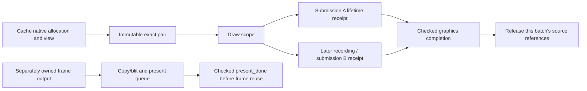

# M4 P2: accelerated native image/view owner handoff

2026-10-24 (Asia/Taipei). Baseline `4ee7ee0fee6bbe48b50618ba3a64c65c9561054e`;
branch `codex/issue-372-fixes`. Personal main stays
`b6a2ce9488d78efdbbeb0efe14c2ec5c0a263e76`. No main merge or manual CI dispatch.

## Baseline and ownership boundaries

AccelerateDisplay returned only raw VkImage/VkImageView values. Layer used them
after unlocking the cache, and later command-buffer recording/native execution
outlived its local FramebufferTextureInfo. Cache DeleteImage/InvalidateScale can
erase/move metadata; the ordinary destruction rings advance by CPU frame count.
That count is not native completion. FrameSkipping can call TickFrame without
acquiring another presentation frame, so the seven-frame/eight-tick comment is
not a complete lifetime proof. Immediate metadata destruction is another route.

Before integration, a deterministic actual-body baseline showed the returned
bare values surviving destruction of their native owner probes by the actual
eight-tick ring without native progress. This is a controlled ownership witness,
not a driver/game UAF reproduction. The same initial audit reproduced
GetRenderFrame ignoring a failed present_done.Wait and proceeding to Reset.
The candidate retainer protocol was tested before Scheduler integration.

## Exact native versions, independent of cache metadata

Image stores its original/scaled native Image allocations in shared RAII owners.
An ImageView captures the exact current allocation at construction, and stores
its primary native views in shared RAII owners. The null-image fallback uses the
same parent-retention rule. No extra Vulkan image/view creation is introduced;
shared ownership wraps the existing objects. Cache IDs and metadata may disappear
while these native objects remain alive.

RetainPresentationSource creates an immutable pair of the exact native allocation
and selected Color2D view. AccelerateDisplay checks that this pair matches both
raw handles before returning it with the copied geometry. It does not retrieve
a newer allocation from a reused cache ID later. The packet's view dies before
its image; assignment cannot invert that order because its members are const.
Image/View metadata move assignment explicitly destroys and reconstructs with a
checked no-throw move, rather than overwriting a parent before its old children.
No native/GPU wait is added under the cache or mapping-use mutex.

## Recording and internal Finish: why one initial receipt is insufficient

WindowAdaptPass owns a presentation-source scope around **all** ConfigureDraw
calls and its final draw recording. Layer's local packet protects preparatory
resource refresh/waits. It then registers its native pair before sampling/filter
recording. The active scope keeps all selected pairs until the final command is
recorded, including across another layer's preparation.

Scheduler records these sources in a separate lifetime ledger. RecordWithUploadBuffer
renews active sources into the current command-buffer batch before enqueueing a
command. SubmitExecution consumes that batch and attaches a private submission
receipt to the existing queue call. Internal AA/FSR Finish can submit/complete an
early batch; active scope ownership survives that completion, and subsequent
recording gets a new receipt. Ending a scope after ConfigureDraw but before the
final WindowAdaptPass record is explicitly rejected by a negative control.

The ledger does not add a Flush/Finish, change command order, replace ordinary
error propagation, or link a source read into data-copy provenance. Tests check
the existing native submission counts, including preparatory/internal splits.
Completed sources are collected at TickFrame and scope entry, because hidden
applet/capture draws can occur without the regular TickFrame path.

## Submission and fence fallback evidence

A lifetime batch retires normally only when its private receipt belongs to this
live Scheduler, has an actual queue attempt and VK_SUCCESS result, identifies
the graphics queue, and has confirmed native completion for that submission tick.
Worker drainage, queue acceptance, scope end and CPU ring age are insufficient.

Timeline mode uses the existing checked counter query plus zero-time host wait.
Fence fallback uses PollNativeResourceLifetime: under free_mutex it rejects the
sticky completion failure and checks only progress acknowledged by actual
WaitThread after a successful native fence wait **and** reset/recycle. This is
combined with the accepted submission/queue identity; it is not a naked cached
tick shortcut. Existing fence completion failure isolation prevents a later
successful fence from leaping over an unknown earlier wait/reset/recycle. The
actual WaitThread/SubmitQueueFence regression now checks the new lifetime poll.

Queue rejection, incomplete recording, query/wait error, wrong queue, missing
attempt or fallback failure retains the native pair. A subsequent confirmed
timeline completion can settle a query-only uncertainty; sticky fallback/failed
submission states are not promoted by a higher counter. No content, visibility,
mapped readback, CPU dirty publication or GuestBackingAdmission is granted.

## Presentation and shutdown release order

The source pair's last covered GPU use is graphics sampling into the independent
Frame.image. CopyToSwapchain's later submission reads that output image, not the
evicted source. The source may therefore retire after its graphics receipt
completes while the output/presentation copy is still pending. The output remains
owned by Frame until checked present_done permits reuse. This does not prove
on-screen scanout or swapchain presentation-engine retirement.

GetRenderFrame now requires VK_SUCCESS before reset/return. Wait failure and
reset exceptions use the existing TerminalFailStop policy with distinct stages;
no uncertain frame reuse, owner unwind or atexit cleanup occurs. Its existing
reservation/counter side effects may already have happened; this is not rollback.

Shutdown first closes source scope/registration/late recording via Scheduler's
owner flag and joins its worker using the existing owning shutdown order. Only
inside Renderer::Shutdown's successful checked device-idle branch, after the
existing controlled-resource preflight, are native source batches retired.
RetirePresentationSourcesAfterDeviceIdle rejects an open Scheduler, joinable
worker or active owner scope. Cancelled/unsubmitted host commands may be released
there because future dispatch is closed and native device use is idle. An
unsettled Scheduler destructor fails terminally before destroying its ledger.

Registration/renewal allocation failures fail terminally while the source root
is still retained; the registration parameter itself remains a strong reference.
Tests cover a second registration failing after the first source's commands were
submitted, retaining both pairs. Partial record/submit failures are not replayed
or converted into no-effects success. Failed idle never releases this ledger.
No source/mapping/handle lock spans native waits or worker joins.

## Windows evidence and its limits

Native source suite: 26 paths, seven protocol paths, seven terminal scenarios,
and fourteen exact controls, each repeated three times. It executes the actual
Image/View retain functions and construction ownership statements, immutable
packet, retainer, AccelerateDisplay, Layer's source-through-AA prefix, Scheduler
registration/RecordWithUploadBuffer/Finish/full SubmitExecution/collection/idle
retirement/destructor, Master timeline/native poll, and presentation frame reuse.
The window's enclosing scope/final-record sequence is represented by the fixture;
the complete WindowAdaptPass is separately production-compiled.

Paths include original/scaled/null allocations; immediate metadata eviction;
delayed recording/submission/native completion; preparation/internal/inter-layer
Finish; fallback plus Finish; fallback wait/reset failure; next-scope collection
without TickFrame; partial recording and host/queue failure; pending presentation
output; closure with a live worker; unsubmitted cancellation; and owner-admission
and renewal failure. Controls omit each parent/view/handoff/renewal/completion/
queue check, end the scope too early, or release before closure/join.

The driver queue, native resources/destruction probes, cache storage, epoch,
preparatory helpers and native progress are controlled fixtures. Source tests
drive fallback acknowledgment; a separate actual Wait/WaitThread/SubmitQueueFence
suite verifies its producer, failure retention and eight negative controls.
The new suite does not execute actual process Memory/GetPointerImpl, a Vulkan
device, GPU shader execution, presentation engine or a game.

Additional evidence: presentation eight normal/worker paths, six terminal paths,
four exact controls three times; actual renderer/worker shutdown ten paths three
times; BlitScreen checked idle four success/eleven failure paths and six controls
three times; mapping-use and packet regressions; submission/content/replica
provenance regression with Windows-supported controls. The latter required a
stale mutation guard to be updated to the current bool preflight; production
data semantics were not relaxed. Linux-only OS enforcement remains skipped.

Eight real Windows AMD64 COFF production units compile using GCC 13.2 and pinned
headers with zero diagnostics: texture cache, Scheduler, rasterizer, master
semaphore, Layer, WindowAdaptPass, renderer and presentation manager. The present
vertex shader header is produced by real glslang. No application link, MSVC,
Linux/Android/device/game or current-head CI acceptance is claimed. See
[input hashes, manifests and cleanup](M4_P2_ACCELERATED_NATIVE_RESULTS.json).

## Continuation boundary

This repairs the selected accelerated native image/view handoff for the covered
consumer route. It does not certify every cache-native producer/helper framebuffer,
capture-output exception path, swapchain image, pipeline/descriptor resource,
guest backing alias or arbitrary escaped native API. Device/allocator lifetime
still relies on the owning Renderer closure/join/idle order; a shared image does
not make an arbitrary packet escape beyond its Renderer legal. Retained native
memory can outlast cache accounting and unknown batches remain pinned until
checked disposal; device memory/performance validation is still required.

Next audit: remaining native helper/output owners and exception paths around
capture/recreation, using the same checked evidence. HostMemory remap/protection
remains high risk. All M4 phases remain incomplete, F2/F3 open, and
GuestBackingAdmission Unknown.

Resume on `codex/issue-372-fixes`; use the commands in the result manifests.
Current-run exe/objects/generated fixtures are removed after hash verification;
logs/JSON remain in `.diagnostics/m4-owner-results`. Main is untouched.

Follow-up: [capture-output and local native upload exception retention](M4_P2_CAPTURE_NATIVE_BORROW.md)
now covers the selected stack-owned output/staging paths. Other helper replacement
and partial applet frame publication remain open as recorded there.
