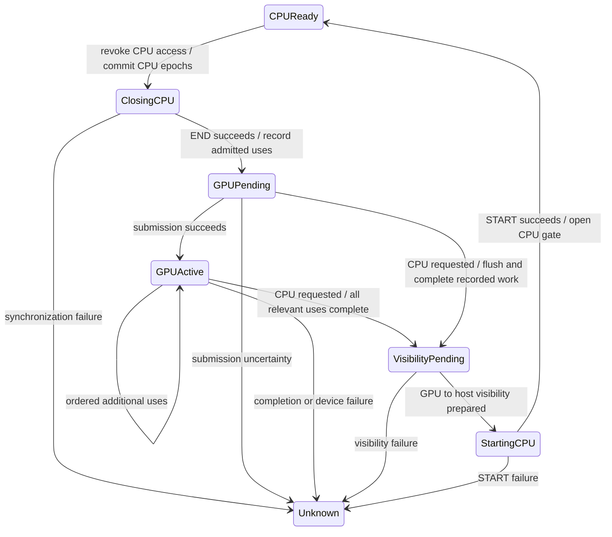

# Phase 3.5B: physical coherency contract and state-machine proposal

Design/audit date: 2026-10-14. Production baseline: `f7c42063f7` on main.
**Proposal only: no production coherency state, ownership changes or direct
bindings are implemented.** The optional DMA audit below exercises existing
functions with fixture mappings, not a proposed production implementation.

## 1. Decision and gates

Recommend **Option A: a backing-scoped physical interval coordinator alongside
the existing DAddr-indexed caches**, introduced first in observation mode and
then for narrowly qualified staged-buffer operations. Preserve the working
upload/download/scatter machinery as transfer adapters, not as authority on
which copy is newest. Keep general DirectGuestView disabled.

This recommendation is conditional. Two gates are not satisfied today:

1. CPU/NCE/kernel access must be admitted and completed through a provable access
   protocol, or the affected pages must be excluded. Existing page faults and
   pre-store API notifications are not complete byte-write tracking.
2. Every potentially overlapping producer, including textures/render targets,
   must participate or cause explicit rejection of the new operation before
   execution. Unknown physical coverage is not evidence of no overlap.

The architecture handles partial byte writes from controlled access paths. It
does not pretend to handle escaped mutable pointers, unknown CPU write completion,
unordered independent writable replicas, or arbitrary image layouts already.
If gating cannot distinguish eligible memory before execution, remain in
observation-only mode rather than silently use an unsound fallback.

## 2. Current production audit

References below name current production functions; line numbers are baseline
navigation hints, not replacement APIs. C = confirmed by source; F = function
fixture reproduction; U = unresolved runtime/coverage assumption.

| Path and source | Identity/state mutations | Ordering actually available | Classification / boundary |
| --- | --- | --- | --- |
| `core/memory.cpp:799 HandleRasterizerDownload`, `:817 HandleRasterizerWrite` | Physical host pointer -> `DeviceMemoryManager::ApplyOpOnPointer/ApplyOpOnPAddr` enumerates DAddr aliases. Read notifications use OnCPURead. Pre-store OnCPUWrite may collect deferred dirty ranges. | CPU preservation route can marshal GPU work before returning; notification is not a post-store completion token. | C: physical fan-out exists for these paths; U: does not cover every raw pointer store. |
| `core/memory.cpp:480 RasterizerMarkRegionCached` | Changes CPU page type and fastmem protection. `cached` controls write permission; reactive flushing affects read permission. | Page protection/fault interception, not an exact byte-write version stream. | C: protection is CPU virtual mapping based, not automatic protection of every alias of a dma-buf. |
| `core/arm/nce/arm_nce.cpp:311 HandleGuestAccessFault` -> `core/memory.cpp:1078 InvalidateNCE` -> `:860 InvalidateGPUMemory` | Fault address aligned to a page; cached memory calls GPU InvalidateRegion for DAddr aliases. Fault handler does not identify exact store extent or distinguish all reads from writes. | Guest resumes after fault handling; subsequent allowed raw accesses have no per-store hook. | C: page-level notification, explicit cross-page TODO. U: completeness and signal-safety for a new blocking protocol. |
| `kernel/k_page_table_base.h:791 GetHeapVirtualPointer`, `.cpp:4234,4368` copies; `.cpp:4644` partial-page initialization | Returns DeviceMemory heap pointer; memcpy/memset accesses physical CPU backing directly. Other raw-pointer users exist. | Kernel/page-table locking orders kernel operations, not automatically Vulkan work or coordinator versions. | C: not every store calls BufferCache::WriteMemory/OnCPUWrite. Some writes are initialization/copies with restricted allocation lifetime; a general GPU overlap claim requires call-site analysis. |
| `buffer_cache.h:1950 FindBuffer` -> `:2097 CreateBuffer/ResolveOverlaps/JoinOverlap` | DAddr page index selects BufferId. DAddr interval overlap combines allocations. | Existing GPU command order and cached IDs; FindBuffer first resolves DAddr-overlapping pending scatter. | C: distinct DAddrs can retain independent resources for identical physical bytes. |
| `buffer_cache.h:2198 SynchronizeBuffer/UploadMemory` | DAddr CPU dirty ranges become staged uploads; shared path uses access/barrier handling instead. Uploads notify overlapping gathers. | Recorded GPU transfer/barriers; CPU freshness is inferred from current DAddr tracking. | C: no canonical cross-DAddr latest-version check. |
| `buffer_cache.h:1942 MarkWrittenBuffer` | Marks DAddr GPU modified, adds exact declared ranges to GPU/uncommitted download intervals, notifies gathers. | Binding bookkeeping predicts writes; it is not proof that recorded/submitted GPU writes completed. | C: writable binding coverage can conservatively exceed actual bytes changed. |
| `buffer_cache.h:2665 PrepareGatherBindings`, `:2902 GatherBuffer`, `:3043 FlushGatherWrites` | GPU-VA-keyed scratch with MM identity/generations; merged same-VA uniform/storage representations; every source chunk synchronized. Post-draw/dispatch marks scatter pending and DAddr GPU dirty. | `vk_rasterizer.cpp:326,749,755` invokes FlushGatherWrites after draw/dispatch recording. | C: pending scratch may be the newest representation before ordinary cache/backing updates. |
| `buffer_cache.h:3071 ScatterGatherEntry`, `:3133 ResolveScatter`, `:2882 NotifyGatherWrite` | Copies scratch chunks to DAddr resources, propagates DAddr dirty notifications, clears pending flag after recording copies. | Commands are ordered; a cleared scatter-pending flag is not CPU-visible completion. Physical alias validation happens before copies; transfers execute after the device snapshot lock releases. | C: cross-DAddr pending producers are not globally coordinated. |
| `buffer_cache_base.h:172 ChannelSetupCaches`, `buffer_cache_base.h:624 GatherEntry` | Channel-specific bindings; ordinary slot buffers are cache-wide. Gathers carry MM identity/generation but are keyed by GPU VA. | Engine/channel sequencing on GPU thread; no canonical physical version across address spaces. | C: cached resources can outlive a single dispatch/channel binding. |
| `buffer_cache.h:2421 DownloadBufferMemory` | Collects dirty copies; staged GPU->staging->guest copy. Special preserve-on-unmap branch clips to allocation, merges completed CPU writes via remaining GPU intervals, clears page state after copying. | runtime.Finish before CPU copies. Direct path waits/barriers/CPU interval rather than CPU copy-back. | C: recently corrected preservation path; ordinary download bookkeeping must become completion-aware in a coordinator, not be blindly reused as transactional commit. |
| `vk_rasterizer.cpp:852 RunBufferCacheCpuWrite`, `:965 UnmapMemory` | CPU-triggered GPU work marshalled through RunOnGpuThread; unmap publishes deferred CPU writes then preserves gathered/staged GPU bytes before invalidation. Texture invalidation is separate. | Cache lock released before CPU waits for GPU thread; GPU-thread callbacks run inline if already there. | C: local unmap fix preserved. `RunOnGpuThread` returns without callback when stopped, so future transactions require explicit success/cancel acknowledgement. |
| `memory_manager.cpp:266 Unmap`, `core/device_memory_manager.inc:207 Map/:272 Unmap` | GPU VA -> DAddr callbacks before PTE removal; device remap callbacks before replacing physical entries. Generation counters bracket actual PTE mutations. | Mapping locks; preservation callbacks occur outside these PTE locks. | C: mapping stamp detects translation changes; no data-version change should be inferred. |
| `buffer_cache.h:40 RunGarbageCollector`, `:2527 DeleteBuffer`, `:2840 TrimGatherBuffers` | GC downloads dirty ordinary buffers before eviction; gather trim scatters pending writes; resize/join transfers data and deletes old IDs. | Delayed destruction; transfers/completion mechanisms on selected paths. | C: preservation is DAddr-local. A future authority producer must retain a lease even when its binding/cache entry is removed. |
| `buffer_cache.h:401 DMACopy`, `:482 TryDirectDMACopy`, `:580 DMACopySplit`; `maxwell_dma.cpp:180` | Plans pieces; direct overlap checks fd/offset, staged split checks DAddr overlap. False returns to scoped guest-memory copy. | Direct/mixed routes may barrier/Finish. Whole-source snapshot is not guaranteed by scoped span. | F: span fallback corruption demonstrated in section 11. Cross-DAddr source freshness remains a separate concern. |
| `buffer_cache.h:1857 UpdateTextureBuffers/:1934 UpdateComputeTextureBuffers`, `:1497/:1642 BindHost*TextureBuffers` | Image/texel buffers bind BufferCache cached VkBuffer views, not ordinary VkImage storage. Writable views use buffer dirty bookkeeping. | Mixed split alias validator rejects known unsafe same-dispatch combinations before binding/dispatch. | C: same-dispatch guard is not a cross-dispatch coherency index. |
| `texture_cache.h:584 WriteMemory/:597 DownloadMemory`, `:2524 MarkModification`, `:650 UnmapMemory` | DAddr CPU-region lookup plus GPU-address-space image mappings; CpuModified/GpuModified image flags and modification_tick. Downloads may unswizzle/swizzle whole image footprints. | Runtime.Finish for synchronous download; async downloads through fencing machinery. Image modification ticks are texture-local, not comparable with buffer data versions. | C: independent representation domain; buffers and tiled images cannot be presumed byte-compatible replicas. |
| `vk_scheduler.cpp:49 Flush/:56 Finish/:218 SubmitExecution`, `vk_master_semaphore.cpp:76 Wait` | Recorded command chunks, queue submission and timeline/completion ticks. | Flush queues submission without waiting; Finish submits and waits. Queue submission result and completion are distinct. | C: these can supply future producer dependencies; a frame number/CPU timestamp cannot. |
| `fence_manager.h:170 TryReleasePendingFences/:194 ReleaseThreadFunc`, `vk_resource_pool.cpp:17 CommitResource` | Fences release pending operations/async downloads; resource pool uses known GPU ticks. | Fence/completion waits, possibly a fencing thread. Not all callbacks are GPU-thread callbacks. | C: publish data only through an agreed completion adapter; no new GPU operations from a fencing/signal thread. |
| `delayed_destruction_ring.h:17 Tick`, `buffer_cache_base.h:662` | Existing eight-frame buffer retirement; texture cache has analogous rings. | Ring age alone is not a general proof of completion or data preservation. | C: leave retirement unchanged; new producer leases/completion guards must satisfy lifetime independently. |
| `vulkan_guest_memory.cpp:421 CreateChunk/:491 ReleaseChunk` | Phase 2 opens one CPU-access interval per exported chunk and ends it on release. | CPU-only backing use; export-only objects destroyed, fd keeps payload. | C: Phase 3 imports privately without commands and does not END CPU access. This is not a concurrent NCE/GPU protocol. |
| `vk_buffer_cache.cpp:118 TryDirectGuestBuffer/:242 BeginGuestCpuAccess/:256 EndGuestCpuAccess/:279 GuestMemoryBarrier` | Legacy direct path tracks CPU intervals by fd; rejects whole-allocation sync above 4 MiB and non-coherent eligibility. | START/END failures throw on active access changes; barriers + GPU waits on CPU transitions. | C: preserve existing safety cap. 32 MiB Phase 2 chunks remain outside this path; diagnostics success does not authorize removing the cap. |

No new global guarantee is inferred from SMU/SMO Phase 3 gameplay. Those tests
used staged rendering and private, unused diagnostic imports. They did not
exercise a Physical Coherency Coordinator or general direct access.

Ordinary render-target chain, distinct from image buffers:
`vk_graphics_pipeline.cpp:553 UpdateRenderTargets(false)` ->
`texture_cache.h:472 UpdateRenderTargets` -> `:2601 PrepareImageView` ->
`:2583 PrepareImage`. Unless a proven full invalidation/clear applies, this calls
RefreshContents and SynchronizeAliases; writable attachments then call
MarkModification, assigning texture-local GpuModified/modification_tick. Sampled
and storage image views originate in FindImageView/FindOrInsertImage/FindImage
(`:1154/:1252/:1261`). This is existing intra-texture synchronization, not a
common ordering domain with BufferCache producers. The future adapter must also
distinguish actual encoded texel coverage from guest pitch/tile padding: a full
image readback is not permission to overwrite every byte of guest_size_bytes.

## 3. Three independent identities/state domains

| Domain | Key / validity | What it does not establish |
| --- | --- | --- |
| Mapping | Phase 3.5A GPU/device lifetime tokens, their generations, MM ID for diagnostics, backing epoch | Data freshness, command-use lifetime, CPU exclusion |
| Data | `(backing_epoch, physical byte interval)` plus authoritative version/producer and replica versions | Vulkan completion, CPU/GPU ownership permission |
| Chunk access | `(backing_epoch, chunk_index, allocation incarnation)` plus leases/completion/visibility state | Which byte intervals were modified or which replica is latest |

Allocation incarnation is reserved for future destruction/re-export of a chunk
within an arena. Current lazy published chunks are immutable and never recycled,
so their existing publication suffices. fd remains a borrowed handle inside an
allocation lease, never the coherency key. Logical 32 MiB partitions can exist
without materialized storage; resolution must not cause allocation.

Same physical ranges from different MM/device tokens share data state. Repeated
segments refer to the same cells, retaining each logical resource offset. Holes
create no cells. A mapping generation bump invalidates a view translation only;
an existing physical version may remain valid. New backing epoch starts a new
coordinator; matching offsets in two epochs never share versions.

## 4. Sparse interval representation and lifetime

Use a **sparse chunk directory + physical interval cells**, with a page-level
reverse CPU-alias/protection index only where required. Do not allocate a static
4 GiB page table. Data authority remains byte-range precise, even if CPU fault
admission is page-granular.

Conceptual structures, not source declarations:

```text
ArenaCoordinator:
  epoch identity, admission/sealing state, next accepted operation sequence
  active chunk directories, interval index, live representation registrations

Cell [physical_begin, physical_end):
  current producer/version, pending dependency if any
  prior version retained until new producer is safely established
  validated replica slices (including CPU backing) and stale replica markers
  write reservation/access lease; error/quarantine state

ProducerRecord:
  operation id, version id, physical footprint, representation lease + byte mapping
  Recorded / Submitted(queue, tick) / Completed / Visible / Failed
  guest-order predecessor dependencies; prior-contents initialization proof

RepresentationSlice:
  stable resource identity + lifetime lease, resource offset/layout conversion
  ordered physical range mapping, valid-version intervals, outstanding readers

ChunkAccess:
  published allocation lease, CPU alias coverage/gate proof
  state, admitted views, maximum outstanding completion per queue, sync error
```

Register buffers/scratch/images lazily against physical intervals. Split cells
at actual write/read boundaries and coalesce only equal producer/version/dependency
and replica-validity state. A replica index links resources to relevant cells;
do not fan out a new write by scanning all GPU address spaces. Use interval
augmentation for intersection lookup. Registration of a huge footprint can
remain interval based rather than enumerate every physical byte/page.

Staged resources retain their existing DAddr BufferIds. The index is an overlay,
not a replacement FindBuffer table. A resource registration has independent
view-translation stamps and physical storage slices. Unmapping a view unregisters
that view only; it cannot delete the last producer of live physical bytes.

**Lifetime:** mapping epoch tokens do not pin allocations. Producer registrations
hold real Vulkan/scratch leases and retain their physical mapping values. CPU
backing operations need an arena lifetime pin or an engine-level pre-teardown
drain while the System still owns the arena. Published chunk leases can pin
exported backing, but no published lease exists for every ordinary/cold range;
an additional general allocation/access lease or strict System lifetime boundary
is a required integration decision, not something 3.5A already supplies.

Preferred ownership placement is a DeviceMemory/backing-epoch coordinator root,
shared by renderer cache registrations and MM views. This matches the actual
physical arena lifetime across game/renderer replacement, rather than creating
independent per-MM coordinators. Before **renderer/device teardown**, seal its
registrations, complete and migrate its authoritative intervals to CPU backing
or another genuinely live producer, then release every lease using that renderer's
VkDevice/dispatch. A coordinator outliving the renderer must not keep a VkBuffer
handle whose device was destroyed. Phase 3's existing leases do not provide a
general VkDevice lifetime extension; a pre-teardown drain is the minimal proposal.

`core/core.cpp:561` applies MADV_DONTNEED after GPU/host1x teardown, with Windows
MEM_RESET at line 572. The physical arena can survive a game switch with the same
backing epoch. These operations are not automatically a zero-fill or new backing
identity on every backing type. Actual initialization/discard semantics must be
handled as explicit quiescent data lifecycle operations, not inferred from mapping
generations. Coordinator metadata may reset/rebase to CPU-backed state only after
all old producers and uses are drained and no old replica/view can reappear;
otherwise actual initialization writes need the normal version protocol.

On whole-arena intentional shutdown: seal admissions, cancel only provably
unexecuted reservations, drain/retire referenced GPU work, then release producers
and backing. An explicitly dead guest epoch has no promise of persistence into
its replacement. Ordinary unmap/remap/eviction of a live epoch must preserve data;
never reuse shutdown discard semantics for those operations.

**Cost estimates (not measured):** 96-160 bytes per interval cell including typical
tree bookkeeping, plus roughly 40-80 bytes per replica link/lease. 16,384 active
cells would cost about 1.5-2.5 MiB before replica links/allocator overhead. A dense
4 GiB/4 KiB table has 1,048,576 pages; at 128 bytes/page it already costs 128 MiB
before range fragments. Sparse pages/chunks fit the current lazy design better.
Expected lookup O(log C + K), mutation O(log C + K + R) for touched cells K and
replicas R; physical resolution remains O(P). These are data-structure estimates,
not FPS predictions.

Fragmentation must be bounded by a metadata budget. Budget exhaustion triggers
safe consolidation: stop admissions for a selected page/range, complete relevant
producers, assemble latest bytes into one retained canonical representation,
then coalesce metadata. If that cannot be done safely, reject new work; never
drop versions or choose a winner merely to save memory. Tune budgets only after
trace/model/device measurements, not from the illustrative sizes above.

## 5. Versions, acceptance order and partial writes

A monotonically increasing **operation/version ID per backing** names an accepted
modification. It is not a CPU timestamp, fence tick, mapping generation or
texture modification_tick. Replica transfers retain the source version; gather,
scatter, download, upload and ownership flips do not themselves create versions.

Admission establishes a guest-valid happens-before relation for overlapping
operations. For one scheduler domain, producer commands and required barriers
are inserted before dependent reads. Cross-channel/address-space operations share
the coordinator but require actual guest/scheduler dependency evidence. Without
it, unordered independent writable replicas are unsupported, not ordered by
whichever host thread grabbed a mutex first. Multiple queues require a completion
dependency set/semaphore edges; taking max of unrelated queue ticks is invalid.

For GPU writes, reserve a producer record before recording, initialize the declared
writable footprint from its required predecessor versions, then attach the real
submission ticket and completion event. Writable descriptor footprint may
conservatively include unchanged bytes; this is safe only because its predecessor
contents were initialized and all conflicting writers/readers were ordered.
Reads depend on a pending newer producer rather than accept an old completed
replica. Recorded-but-unsubmitted work may need submission on CPU access; it
cannot be waited on as though a valid fence already existed.

For controlled CPU writes, acquire a physical write lease before the store,
preserve prior contents required by granularity/other live bytes, then **commit
after the actual store completes**. Current pre-store OnCPUWrite/deferred dirty
collection needs an adapter/completion boundary; it is not itself this protocol.
Exact writes may supersede their bytes without downloading obsolete bytes, but
must preserve unrelated authoritative GPU bytes and outstanding read operands.
Never publish CPU freshness merely because notification was called.

Example with established operation ordering:

| Page X bytes | Latest version/location | CPU replica | Staged A replica |
| --- | --- | --- | --- |
| `[0x000,0x040)` | v12, completed CPU write 77 | v12 valid | stale on this interval |
| `[0x040,0x080)` | v11, GPU A write 99, completion pending/completed as recorded | stale until downloaded | v11 pending/valid |
| `[0x080,0x1000)` | v10, unchanged prior data | v10 valid | v10 valid if initialized |

GPU completion of v11 after CPU v12 does not make v11 newer on the first interval.
Only download `[0x040,0x080)` into CPU backing. An aligned transfer may overfetch
into a private staging allocation, but CPU write-back is clipped to cells whose
producer/version still matches. Do not clear page-level dirty state until all
remaining authoritative GPU intervals represented by that bit are reconciled.
Existing dirty flags can be conservative scheduling hints, never sole authority.

## 6. Invariants and existing enforcement

| Invariant | Existing enforcement | Required new enforcement |
| --- | --- | --- |
| I1 stale replicas never overwrite newer data | Local dirty intervals/preservation fixes; not universal | Version check at transfer planning AND publication; exclude superseded bytes |
| I2 reads observe guest-ordered latest data | Same-resource GPU ordering and local downloads | Physical read admission depends on latest producer across all registered replicas |
| I3 pending writes survive live unmap/remap/eviction | Corrected buffer unmap, gather resize/trim, dirty GC locally | Producer leases and physical-preservation transactions independent of view keys |
| I4 disjoint CPU/GPU subranges coexist | Exact GPU intervals plus coarse tracker bits, limited CPU preservation | Byte cells and completed CPU-write commits; coarse bits must not erase cells |
| I5 distinct DAddr/MM aliases share data authority | Resolver can identify them; ordinary cache does not coordinate them | One arena coordinator and physical registration index |
| I6 remap/unmap is not a CPU store | Unmap now preserves first, then local invalidation | Separate RemoveView/PreserveProducer operations, no invented data version |
| I7 mapping validation is not dispatch permission | 3.5A contract explicitly states this | Protected use admission/retained representation or ordered mutation handshake |
| I8 backing replacement cannot reuse stale state | Backing epoch and mapping lifetime tokens | Seal old coordinator; never publish its completions to a new epoch |
| I9 pending GPU use retains resources | Existing fences/pools/rings on relevant paths | Producer/read-use leases and actual completion before lease release; leave eight-frame ring intact |
| I10 unsafe same-dispatch writable aliases rejected before work | Split mixed-binding validator covers a subset | Preflight all relevant representation/storage aliases, including unknown texture overlap |
| I11 sync/submit errors preserve dirty/pending state | Some legacy access failures throw | Failed/unknown state, no false success/dirty clearing; cancel only proven unexecuted work |
| I12 data versions and access ownership independent | Existing APIs separate some operations, no unified contract | Two state domains; copies/flips retain data version |

## 7. Common transaction protocol and transitions

Each operation first resolves ranges and prepares a plan **without** holding
coordinator/cache locks across PTE resolution or GPU waits. At acceptance it
must acquire an enforceable mapping-use contract, not just call Validate and
dispatch later. A future per-manager active-use/mutation-admission handshake can
register resolved use while both PTE locks protect the stamp, then force Map/Unmap
to preserve/retire accepted uses before mutation. That is a future change requiring
new lock review; no such guard exists in 3.5A. Retaining physical values/resource
leases alone preserves old work but does not atomically order new dispatch vs remap.

Required handshake shape: each manager has a separate mutation-admission gate.
A mutator declares intent and closes new-use admission **before** invoking existing
preservation callbacks, then drains affected accepted uses without holding PTE
locks, and only afterward changes PTEs. A reader acquires the GPU/device admission
gates in the agreed order, validates/reserves its use under GPU->device PTE locks,
then releases PTE locks before recording or waiting. Existing device Map's PTE
lock alone is insufficient because its callback has already run by that point.
Accepted operations must either finish before mutation or convert to fully pinned
physical/resource use that never re-translates a changed DAddr. This is a protocol
requirement; whether a minimal gate can meet existing scheduler/CPU lock constraints
must be proven in M3 before activating any GPU consumer. No GPU/PTE lock may be
held while waiting for a use that needs that same lock/thread to finish.

Coordinator locks protect only metadata. Prepare -> reserve -> release locks ->
GPU-thread record/wait -> conditional commit. Reserve tickets prevent overlapping
CPU commits/new producers during the unlocked transfer window. Never wait on GPU
while holding a lock the callback needs. No coordinator->PTE nesting; initial
snapshot order remains GPU->device. Cross-coordinator operations acquire metadata
locks in backing-epoch order or use a two-phase reservation plan.

Notation in the table: P = resolved physical intervals, M = protected mapping-use
admission for GPU-address operations (or stable physical lease for CPU operations),
L = latest producer, R = target replica. Any error before recording releases a
reservation only if no effects occurred; submission/visibility uncertainty enters
Failed/Unknown, preserves producers and stops affected execution. Failures never
silently clear dirty intervals.

| Operation | Preconditions / current authority | Actions and synchronization | Publication / deferability / failure |
| --- | --- | --- | --- |
| CPU read | Stable physical CPU alias lease; P may have pending L | Complete/submit required GPU writers, download only CPU-stale current-version intervals; shared backing additionally uses chunk CPU gate | CPU read begins only after CPU visibility. Synchronous for immediate read; speculative prefetch may defer but must recheck versions |
| CPU exact write | Known bytes, pre/post store boundary, exclusive reservation for conflicts | Wait conflicting operations; preserve complement required by coarse tracking; close outstanding GPU readers before reuse of storage; perform store | Commit CPU version after store. No full-page overwrite/readback assumption. Failure before store cancels; unknown store completion is quarantined |
| NCE raw read/write | All aliases tracked AND a revocable page/chunk access epoch, instruction/access coverage known or conservatively exclusive | Fault cannot simply publish exact-byte modification. Complete required producers before granting access, preserve whole page if arbitrary writes allowed; exclude GPU conflicting access until gate closes | CPU epoch may defer precise dirty classification until a proven end boundary. Unknown pointer access/gate coverage blocks new coherency/direct path |
| GPU staged read | M, R's physical registration, all overlapping producers known | Populate stale R slices from L with GPU transfers/barriers if possible; otherwise wait/download/encode/upload through CPU rendezvous | No new data version. Can remain asynchronous with dependencies in command stream; never upload stale CPU bytes merely because DAddr flags say dirty |
| GPU staged write | M, preflight aliases, predecessor data initialized for declared writable footprint | Reserve new producer/version, record command; establish read/write barriers and attach submission/completion ticket | Record pending latest producer; complete status later. CPU reads must depend on it; failed submit is not completion |
| Gather | M, logical segment order, physical repeats classified, latest L per mapped slice | Fill scratch from L. Duplicate read-only physical segments copied as separate logical occurrences; writable same-dispatch conflicts preflighted | Scratch receives existing versions. GPU copies may defer; holes keep defined existing binding semantics, never create physical state |
| Scatter | Scratch is retained L for the intervals, dependencies known | Transfer only intervals still authoritative for that scratch version; superseded intervals have already been transferred to a newer producer or overwritten by an ordered operation | Ordinary replica receives same versions after completion; original producer survives until then. Excluding superseded intervals is a versioned preserve decision, not silently skipping pending scatter |
| GPU VA unmap | Mutator admission blocks new uses; old P/M retained | Resolve pending physical producers before view removal; preserve live physical data in retained representation/CPU as required. Order old GPU use before mutation completion | Remove view/stamp, not physical versions. Synchronous if caller relies on mapping release; internal retention can defer only with explicit allocation lifetime guarantee |
| Device physical remap | Old DAddr->P known, mutation blocked behind accepted uses | Preserve old P producers; unregister old view; change PTE only after old uses safely retired/retained; new translation resolves separately | No CPU version invented. New physical bytes carry their own current versions; old alias mappings can survive |
| Resize/rebind | Old producer may be scratch/staged latest; M for new view | Retain old allocation; populate replacement from current physical versions, transfer dirty slices, update registrations only after plan commits | Deferred GPU transfer allowed; never free/reset old authority merely because size changed |
| Eviction | Resource has authoritative/pending cells or outstanding readers | Transfer authority to another retained representation, or download then conditionally commit; wait completion before dropping final producer lease | Clean replicas can unregister immediately; authoritative/pending producer cannot. GPU-safe retirement remains separate from data preservation |
| DMA read/write | Whole-source physical snapshot contract; mappings and all producers controlled | Reconcile latest source, capture entire logical source into owned storage before destination mutation for overlap; reserve destination writes; define repeated destination order; preserve unrelated bytes | One accepted operation with destination versions after copy completion. Non-overlap GPU copies can defer. Missing source freshness/alias evidence rejects before partial copy |
| DirectGuestView acquire | M, one materialized compatible chunk, physical continuity, every competing producer reconciled, chunk CPU coverage proof | Obtain cached import lease + range registration, admit view through chunk state machine. Validate usages/alignment/external/dedicated/handle requirements | No data version on acquisition. No authorization from mere import success. Any unmet condition falls back only to a proven staged path, otherwise rejects |
| CPU->GPU ownership | Chunk CPU gates closed, no escaped accesses, CPU writes committed, latest backing slices initialized | END current CPU access interval, required cache/exporter operations and host->GPU dependency; admit recorded views | Chunk enters GPU Pending/Active; no data modification solely from flip. END failure -> Unknown, no GPU execution |
| GPU->CPU ownership | New GPU admissions closed; all chunk uses accounted for | Submit outstanding recorded work, host-visibility dependency, wait all relevant queue completions, then START CPU access | CPU gate opens only after visibility/sync succeeds; no readback copy for already-latest shared bytes. START failure -> Unknown, retain data and deny CPU access |
| Arena teardown/replacement | Seal coordinator, prevent new CPU/GPU use, old epoch still lifetime-protected | Drain pending accepted work and cleanly retire leases; preserve required live-guest bytes before replacing observable backing | Invalidate old identities; new coordinator starts independently. Explicit terminal guest destruction is distinguished from live remap; unknown GPU completion prevents unsafe release |
| Renderer/cache teardown while arena survives | Seal this renderer's registrations; coordinator may outlive its VkDevice | Complete/preserve its physical producers into CPU backing or a live alternate device, drop all device-dependent registrations before device/dispatch destruction | Data versions may remain in arena state, but no dead-device resource lease may remain; shutdown cancellation is not proof of a successful drain |

First integration may use existing Finish/CPU rendezvous for difficult staged
transfers. That is a correctness cost, not a requirement to globally stall every
dispatch. GPU->GPU transfers with valid dependencies can avoid CPU round trips.
No callback may equate `RunOnGpuThread` return with completed GPU execution or
success after shutdown without a transaction acknowledgement.

## 8. NCE/raw-pointer coverage: blockers and feasible choices

Confirmed coverage gaps: normal NCE code executes guest loads/stores directly;
only protection faults enter HandleGuestAccessFault. InvalidateNCE is a page-level
invalidation, not an exact read/write/commit protocol. A writable page can receive
many stores after its first fault. Heap/physical host aliases are not automatically
protected by protecting fastmem virtual addresses. Existing raw-pointer accessors
can return mutable pointers without a bounded lease. Some kernel memcpy/memset
sites bypass the memory API notifications; kernel locking alone does not supply
GPU data freshness. No full enumeration/revocation of escaped pointers is proven.

Current NCE invalidation routes through InvalidateRegion, not the exact pre-store
OnCPUWrite route on every fault. Whether staged GPU writes are preserved in every
such fault scenario needs a dedicated production-function/device test; do not
claim the prior CPU-write fix proved NCE coverage. This audit records the risk,
not an Android reproduction of corruption on that route.

| Strategy | What it can guarantee | Cost/threading/portability and required work |
| --- | --- | --- |
| Existing Memory APIs + explicit pre/post leases | Exact known access scopes after adapters surround actual copy/store | Lowest disruption for controlled paths; must cover safe/unsafe APIs, inline/kernel writers and escaping pointers. APIs alone cannot cover unrestricted NCE |
| Page protection/fault epochs | Arbitrary accesses within protected coverage can be conservatively treated as page-exclusive CPU epochs | Need all process/physical/separate-heap aliases, split-page operations, reads vs writes, revocation, CPU safepoints/TLB/protection coordination. Linux/Android mprotect exists but signal-handler locking/waits are not automatically safe; Windows/JIT needs a different adapter |
| Conservative CPU/GPU boundary rendezvous | At a proven boundary, stopped CPU writers + reconciled backing allow safe transfer | GPU submission is not a CPU safepoint today. Pausing all NCE cores per dispatch could be prohibitive and is not recommended; syscall/end-frame boundaries alone do not prove no escaped kernel worker accesses |
| Restrict new path to provably controlled CPU access | Narrow correctness domain with explicit access leases and no unregistered writers | Preferred first stage; allowlist must be positively proven. Unknown coverage -> staged old path outside new coordinator or explicit rejection, not declaration of full correctness |
| Restricted CPU page epochs with whole-page preservation | Before unprotecting, reconcile all GPU bytes on that page; treat CPU backing as exclusive until a proven re-protection/quiescence boundary | Coarse access policy, not coarse authority model. No independent GPU producer on potentially touched bytes during the open epoch; exact CPU/GPU subrange coexistence resumes only after actual write information or safe epoch closure |

Preferred: controlled API leases first; shadow physical indexing for all observed
resources; research fault epochs separately. General 32 MiB direct backing stays
blocked until a chunk-wide CPU access gate is proven. Do not use raw CPU wall-clock
timestamps or a first fault as an end-of-write notification.

NCE signal handling needs an explicit safe handoff/trampoline to ordinary host
execution for blocking GPU/coordinator work, with no self-wait or reentrant mutex
deadlock. Existing handler code is not proof that adding more locking is safe.

## 9. Cross-dispatch and simultaneous aliases

Initial X=10. Dispatch A resolves VA A/DAddr A to X and writes staged A=99.
Before recording it, register A as pending producer v11 for X, retaining its
allocation. Dispatch B resolving VA B/DAddr B to X queries the same cells, sees
v11, and requests a valid replica:

1. If its buffer already shares A's actual storage, insert the required dependency
   and reuse it.
2. If B is independent, copy A's authoritative bytes to B with GPU barriers/order.
   If no compatible GPU transfer/layout adapter exists, complete A, download into
   private storage, conditionally reconcile CPU backing, then upload B.
3. Do not upload CPU value 10. Once B's copy completes, B is a valid v11 replica;
   this transfer creates no new version.

Same/different MM and DAddr affect mapping admission, not cell lookup. Partial
overlap copies only intersecting stale cells. A pending scratch producer is L,
even before scatter; B can copy from it or force ordered scatter, retaining its
lease. Eviction between A and B preserves that producer independently of cache
IDs. Remap preserves old physical X state while B's fresh translation may point
to X or different Y; old stamp cannot authorize new work.

Texel/image **buffers** use the BufferCache representation adapter with their
own usage/barrier requirements. Ordinary textures/render targets require an
image-layout adapter: decode GPU storage, encode exact guest layout into private
staging, publish only authoritative physical cells. Existing full-image downloads
must not overwrite newer CPU/buffer intervals. If layout/footprint conversion is
unknown or cannot be reconciled, reject the new overlapping operation. Texture
cache alias flags/modification_tick alone cannot arbitrate against buffer versions.

Within one dispatch, post-dispatch invalidation is insufficient. Independent
allocations representing overlapping physical bytes cannot model a shader's
load-after-store/atomic alias relationship. Allow only:

- demonstrably read-only copies at required versions with no competing writer;
- actual shared storage covering all relevant descriptors with correct Vulkan
  alias usage/barriers and shader synchronization;
- existing storage/uniform views sharing the same prepared scratch positions,
  after physical validation.

Repeated physical pages at different offsets of one dense writable binding are
not representable by an ordinary linear buffer. Cross-chunk linear bindings are
not representable by a single per-chunk direct view. Validated sparse aliasing or
shader address translation would require a later architecture change. For now,
reject these unsupported writable cases **before any affected GPU work**; do not
skip scatter, discard writes, or reinterpret a warning as fallback. Unordered
cross-channel overlapping producers also require an explicit supported ordering
or shared-storage semantics; physical identity alone does not decide the winner.

## 10. Chunk access state machine (separate from data versions)

All direct views of one published allocation share a single ChunkAccess object,
one import lease and one access interval state. No per-view START/END. Existing
Phase 2 CPU-only interval policy remains unchanged until this protocol is proven.



| State | Permitted access / outstanding obligations |
| --- | --- |
| CPUReady | Admitted CPU/NCE accesses only, GPU inactive for this chunk; physical data may still have latest staged producers elsewhere |
| ClosingCPU | No new CPU admissions; wait/revoke every CPU alias epoch, preserve/reconcile backing bytes; no GPU execution yet |
| GPUPending | CPU excluded, commands may be recorded but not submitted; cancellation possible only before any observable effects |
| GPUActive | CPU excluded; ordered GPU views can reuse access state without repeated ioctl; completion dependency set includes reads and writes. The GPU interval may remain owned but idle after completion; no CPU flip unless CPU access is requested |
| VisibilityPending | Completed GPU work still needs host visibility/exporter cache transition; completion is not CPU readiness |
| StartingCPU | No CPU use until sync acknowledgement; one chunk-level START |
| Unknown | Deny both admissions, retain producer/resource state; fail affected operation/emulation if recovery cannot prove data intact |

Synchronization contract follows the Linux [dma-buf CPU access interface](https://docs.kernel.org/driver-api/dma-buf.html#cpu-access-to-dma-buffer-objects):
START/END bracket mmap access, retry EINTR/EAGAIN as required, and do not themselves
exclude CPU/GPU clients. Explicit completion waits and client exclusion remain
necessary. The ioctl has flags but no byte-range argument; a tiny view can incur
whole-allocation work. Vulkan [execution/memory dependencies](https://docs.vulkan.org/spec/latest/chapters/synchronization.html)
separately establish ordering and visibility. [HOST_COHERENT](https://docs.vulkan.org/refpages/latest/refpages/source/VkMemoryPropertyFlagBits.html) removes some mapped
Vulkan cache-maintenance requirements; it is not proof that arbitrary external
mmap aliases can ignore exporter synchronization or outstanding GPU work.

Non-coherent memory requires the correct ownership/cache protocol for the actual
CPU alias. vkFlush/vkInvalidate on a different vkMapMemory pointer is not presumed
to repair the original guest mmap. Compatibility and exporter guarantees must be
verified before admission. Until then use proven staged access; do not expand the
legacy eligibility predicate or remove its large-backing fallback here.

Unrelated CPU access anywhere else in the same 32 MiB chunk matters: it cannot
continue unrestricted during GPUActive merely because the bound view is 64 KiB.
If all aliases cannot be quiesced/revoked, **direct chunk ownership is blocked**.
Driver-specific simultaneous access is a separate capability requiring proof,
not inferred from UMA/Android/Adreno or the observed memory flags 0x7.

On failure, keep exact producer/version records. Failed END means do not submit;
failed START means do not let CPU execute. Retry recoverable ioctl errors without
publishing readiness. After possibly executed writes, no automatic staged
downgrade; recover only by a proven completion/visibility/preservation protocol,
otherwise stop while retaining safe resource lifetimes.

## 11. Independent overlapping DMA audit

**Confirmed correctness defect under the intended whole-source-before-destination
fallback contract; no Android/game reproduction claimed.** No assertion about
undocumented NVIDIA hardware overlap behavior is made.

Chain: `MaxwellDMA::Launch` pitch->pitch (`maxwell_dma.cpp:180`) -> accelerated
BufferCopy returns false -> `GpuGuestMemoryScoped<SafeReadCachedWrite>` with
`read_buffer` supplied -> production `GuestMemory::Read` (`core/guest_memory.h:102`)
calls TrySetSpan (`:144`) -> continuous source is a borrowed span, even though a
backup buffer was supplied -> SetAddressAndSize -> scoped destructor (`:190`)
calls `MemoryManager::WriteBlockCached` -> WriteBlockImpl<false> (`memory_manager.cpp:493`)
uses page-wise memcpy. The accumulator records destination invalidation, but
does not retroactively snapshot source or make the earlier reads atomic.

Fixture proof, 4 KiB pages:

```text
physical bytes initially: [page0 = 10] [page1 = 20] [page2 = 30]
source logical span:      [page0, page1]
destination mapping:     [page1, page2]
first memcpy: page0 -> page1, so page1 becomes 10
second memcpy: now-mutated page1 -> page2, so page2 becomes 10
actual destination:      [10, 10]
required source snapshot:[10, 20]
```

Every individual memcpy in this proof has disjoint source/destination ranges.
The failure therefore does not depend on undefined behavior from an overlapping
single memcpy. Ordinary same-call overlap also reaches memcpy and is not a
supported memmove proof. The owned-source control produces `[10,20]`.

`audit_dma.py` compiles the actual GuestMemory/GuestMemoryScoped header, extracted
production MemoryOperation, ReadBlockImpl/ReadBlock, WriteBlockImpl/WriteBlockCached;
fixture page entries, GetSpan selection, device pointer translation and no-op
cache callbacks supply mappings. Both Windows MinGW and Linux GCC reproduce the
defect and pass the owned-source control. This is a production-function data-flow
test, not a full DMA engine/GMMU/driver test.

Boundary classification:

| Case | Classification |
| --- | --- |
| Whole-source direct-span fallback above | Confirmed function-level corruption |
| Owned source via failed GetSpan, CPU bytes already latest | Protected by actual source copy in ReadBlock; control verified |
| Independent per-copy non-overlap with physical aliases between pieces | Not protected by each memcpy; proof above |
| Latest GPU producer only reachable through another DAddr | Freshness risk remains; source-copy ownership alone does not solve it |
| Direct DMA plan fd/offset overlap checks | Avoids that direct copy, but returning false is not enough because borrowed fallback can still fail |
| Split staged overlap checks using DAddr only | Does not establish absence of different-DAddr physical aliases; separate physical preflight required |

Proposed **separate targeted fix**: give the DMA fallback an explicit owned-source
snapshot operation, capture the entire logical source after required existing
flushes and before any destination mutation, then write destination in specified
logical order. Do not change all GuestMemory span users. OOM/invalid mappings
must fail before partial destination writes. Merely substituting memmove per
piece does not repair earlier-piece clobbering of later source pages.
Add tests for source/destination partial overlap both directions, multiple pages,
split source/destination, different-DAddr aliases, repeated destination pages,
borrowed-span-with-supplied-backup, owned control, and no-write-on-failure. Keep
cross-DAddr latest-producer reconciliation explicitly separate until integrated.
No DMA source changes are made by this design/audit.

## 12. Option A vs Option B

| Criterion | A: physical coordinator + current DAddr resources | B: deeper physical-keyed resource storage |
| --- | --- | --- |
| Primary modules | BufferCache registration/read/write/gather/scatter/GC; CPU access adapters; texture adapters; mapping-use handshake; scheduler completion adapter | Above plus FindBuffer/overlap/page indexing, binding views, buffer allocator/import architecture, more cache lifecycle assumptions |
| Source-based advantage | Existing FindBuffer, uploads, readback preservation and scatter transfers can be retained; only authority decisions move | One actual resource can serve many physical aliases when their ranges are expressible |
| Metadata/resource cost | Sparse cells + replica links; still duplicates staged payloads and may transfer between them | Canonical interval resources + mapping view metadata; can reduce duplicate buffers, but split/tiling/image representations remain |
| Locks/hot path | Physical registration cache keyed by stamp; interval lookups on accepted accesses; metadata reservations and dependency tickets | Physical lookup/overlap on every view acquisition; page/sparse/descriptor management and same access gates still needed |
| Correctness risks | Missed producer registration, stale publication after unlocked transfer, bypass CPU writes, adapter ordering | Remap/lifetime mistakes, buffer/image alias restrictions, existing dirty-index assumptions, unrepresentable linear views |
| Image/texel compatibility | Texel adapters use existing buffers; ordinary images require layout conversion/exclusion | Physical VkBuffer does not automatically replace optimal-tiled VkImage; dedicated/usage/granularity constraints remain |
| Rollout | Observation-only index, then scoped staged operations, independent opt-in gates | Broader resource-key migration is harder to isolate and roll back |
| Same-dispatch aliases | Share existing proven scratch/storage or reject | Can improve contiguous single-chunk shared buffer views; repeats/cross-chunk/image aliases still need supported backend or reject |
| CPU/NCE blocker | Must be solved or restrict eligibility | Must still be solved; physical resources do not intercept raw CPU stores |

Recommend A now because production caches already have mature DAddr lifecycle,
local preservation, cached bindings and fallback transfers. A coordinator can
reuse those without touching the eight-frame mechanism. B does not remove the
hardest blockers (raw CPU access, ordering, image layouts, repeated-page shader
semantics), while expanding remap/binding/allocator risk. Reconsider B only if
measured copy/replica overhead or A's safe registration boundaries become a
demonstrated obstacle. Neither option promises a universal fallback today.

## 13. Independently testable roadmap

All new operational modes default off. Turning a flag off is not a rollback while
the new mode owns pending writes: seal, drain/transfer authoritative versions,
wait completion, then detach. If that cannot be proven, stop the guest and retain
safe resources rather than continue with stale old caches.

| Milestone | Scope/modules and invariants | Tests / device requirement | Rollback and advancement gate |
| --- | --- | --- | --- |
| M0 independent DMA snapshot fix | MaxwellDMA fallback/GuestMemory-owned-copy helper only; source snapshot before writes | Function repro above plus split/overlap/physical-alias/error cases; Android SMU/SMO DMA-heavy test needed before default rollout | Revert separate commit while retaining original build; no claim to fix cross-DAddr freshness |
| M1 coverage audit + shadow registrations | Buffer/texel/image/CPU access observation adapters using resolver; no transfer/ownership changes | All binding types, across MM/DAddr, remap/unmap, CPU/kernel/NCE coverage tracing; device measurements needed for coverage/hot-path cost | Disable diagnostics directly because no new data authority exists; advance only with explicit coverage exclusions |
| M2 pure coherency model + failure tests | Standalone model of interval authority, reservations, versions and causal completion, no rendering integration | Property/random tests against a reference byte-array execution model; no device requirement | Discard model changes freely; prove I1-I12 for supported controlled-access domain |
| M3 controlled CPU leases + mapping-use/completion contract | Exact Memory API wrappers, kernel adapters, GPU-thread acknowledgement, mapping mutation admission | Pre/post stores, deferred notification, concurrent remap, shutdown-cancel, self-wait, lease lifetime and async completion failures; Android NCE/kernel tests required | Disable only after leases drained; stop if escaped pointer/unknown commit completion cannot be excluded |
| M4 scoped staged-buffer coherency | Keep DAddr resources; overlay physical authority on supported buffer/texel reads/writes, uploads/downloads, gather/scatter and GC | 10->99 across different DAddr/MM, partial CPU77/GPU99, pending scratch, scatter/resize/evict/remap, actual runtime barrier ordering; Android test required | Drain latest producers to legacy representations under gate; advance only when no known participant is omitted |
| M5 image/other binding interop + complete rejection | Texture guest-layout adapters or explicit preflight exclusion; vertex/index/TFB/query/indirect and other relevant readers/writers classified | SSBO99/image77, tiled footprint conversion with newer CPU intervals, color/depth/MSAA/compressed unsupported cases; device tests required | Retain scopes that can drain; unknown footprint/repeated writable storage remains rejected |
| M6 CPU/NCE page/chunk access-gate feasibility | NCE fault epochs, all CPU alias inventory, safe host trampoline/quiescence; initially observation/exclusion only | Read vs write faults, cross-page/atomic ops, multiple NCE cores, raw kernel pointers, CPU aliases outside bound view, async-signal safety; Android/Linux tests essential | Do not open any direct GPU access until gates proven; stop if coverage or acceptable overhead cannot be established |
| M7 selective DirectGuestView (later Phase 4) | Reuse Phase 3 import leases; controlled chunks, one shared ownership state, range coordinator already functional | Real device shared-byte reads/writes, same chunk multi-view reuse, START/END failure, coherent/non-coherent capabilities, chunk-wide unrelated CPU access, cross-chunk fallback | Keep large-backing fallback until validation. After submitted direct writes, rollback requires proven drain/visibility and producer transfer; never flip to scratch blindly |

Milestone ordering permits M0 independently. M1/M2 may proceed before CPU gates,
but M4 cannot claim correctness outside the M3 controlled-access domain, and M7
is blocked on M5/M6 and actual driver synchronization validation. No direct view
is enabled during coherency integration.

Explicit stop conditions: unobservable CPU/NCE writes; missing guest-order or GPU
completion proof; shutdown callback without success acknowledgement; unsupported
same-dispatch writable storage; unknown image/producer footprint; remap-use gap;
sync uncertainty; excessive metadata growth, transfer volume or lock/wait latency;
unsupported external memory/usage/dedicated/cache-maintenance requirements.
Performance thresholds need measured baseline and agreed budgets before activation;
no claimed FPS benefit or arbitrary measured threshold exists in this design.

## 14. Regression specification and remaining questions

Model tests must use exact byte arrays, separate accepted/submitted/completed
events, versioned replicas, injected failures and explicit CPU/GPU access leases.
Do not write a test that merely mirrors dirty flags. Minimum acceptance traces:

1. CPU77 `[0,64)` and GPU99 `[64,128)` survive downloads in either completion order.
2. A writes 99, B initially 10 through different DAddr and MM; B reads 99, no stale upload.
3. Partial/repeated physical overlaps and holes; no cell for a hole, no duplicated authority.
4. Scratch99 followed by image-buffer77: ordered separate dispatches preserve 77;
   unsafe same-dispatch independent allocations rejected before commands.
5. Texture encode/download overfetch never publishes superseded CPU/buffer cells.
6. Resize, remap, unmap, binding cache reuse and eviction retain pending producers.
7. Recorded-but-unsubmitted and submitted-incomplete writes cannot be read as completed.
8. Out-of-order completion cannot roll back a later accepted, guest-ordered version.
9. CPU pre-store notification without store completion blocks dependent readers.
10. Mapping validation followed by remap cannot admit an unprotected dispatch.
11. Owner/backing replacement never receives old completion callbacks into new state.
12. All-buffer bindings and ordinary images either register exact/conservative safe
    footprints or explicitly prohibit overlapping new-mode operations.
13. NCE writes after first fault, read faults, cross-page operations and escaped
    heap aliases expose missing coverage rather than pass via assumed callbacks.
14. Same chunk multiple views use one interval; unrelated CPU access cannot ignore GPUActive.
15. START/END EINTR/EAGAIN, hard failure, submission failure and device loss retain state.
16. Metadata-budget consolidation preserves byte contents or rejects atomically.
17. Shutdown/RunOnGpuThread cancellation cannot return a false transaction success.
18. DMA borrowed vs owned source, full-operation overlap and failure atomicity.
19. Existing gather/scatter, unmap/CPU preservation and lazy/import suites remain unchanged.
20. Disabled new flags incur no transfer, ownership or descriptor change; measure resolver
    revalidation failures, resolution time, cells/replicas, copy bytes and CPU waits separately.
21. Renderer teardown with a surviving arena drains its authoritative producers;
    no old VkDevice/dispatch lease survives, and quiescent memory reset does not
    accidentally reuse stale replica versions with an unchanged backing epoch.

Open decisions: final ownership/drain plumbing for the proposed DeviceMemory-level
coordinator across renderer replacement and quiescent guest-memory reset;
general backing allocation pin; active-use/mutation handshake; CPU write commit
boundary and NCE alias inventory; image conversion footprints; multiple-queue
dependencies; guest race policy; metadata/performance budgets; real exporter cache
guarantees for mmap aliases. These are explicit future gates, not completed work.

## 15. Deliverable validation

Production files remain byte-identical to `f7c42063f7`. Only this document and the
standalone audit fixture/runner are added. The DMA audit is reproducible with:

```sh
python tools/physical_coherency_tests/audit_dma.py --cxx g++
```

Windows MinGW and Linux GCC both reproduce borrowed-source corruption and pass
the owned-source control; Linux AddressSanitizer/UndefinedBehaviorSanitizer also
passes that audit. No Phase 3.5B APK, Android GPU execution, coherency
state machine implementation or performance benchmark is claimed. There is no
reason to rebuild/retest unchanged production gameplay solely for this document.
Stop after design/audit; implementation needs explicit approval.
