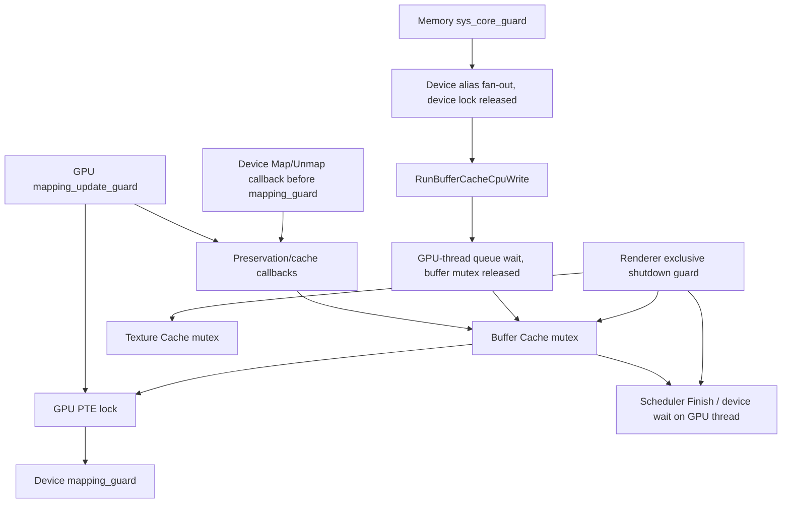

# M3A: controlled CPU access and mapping-use admission

Baseline: `main` at `a82f330469`. This directory implements an isolated C++20
protocol prototype. Nothing is linked into the emulator; no setting, GPU command,
wait, dirty flag, dma-buf ownership transition, import, or retirement policy changes.
The Phase 3.5A resolver, M1 shadow and M2 reference model retain their meanings.

## Production audit

The following references describe the baseline source, not hypothetical adapters.
Line numbers are navigation aids; the named functions identify the audited edges.

| Existing edge | Source | Lock/callback consequence |
| --- | --- | --- |
| GPU Map/MapSparse -> NotifyMappingChange -> preservation callbacks -> PTE update | `src/video_core/memory_manager.cpp:132,242,259` | `mapping_update_guard` spans callbacks. GPU PTE inspection releases its read lock before callbacks; mutation later acquires the PTE lock. |
| GPU Unmap -> GetSubmappedRangeImpl -> rasterizer UnmapMemory -> NotifyMappingChange -> PageTableOp | `memory_manager.cpp:271` | Preservation precedes PTE removal, under the update guard. No admission reservation presently spans validation through GPU use. |
| ResolvePhysicalRanges -> ReadPhysicalMappingSnapshot | `memory_manager.cpp:63`; `src/core/device_memory_manager.h:144` | GPU page-table lock then device mapping lock, held together for pure translation. |
| ValidatePhysicalSnapshot | `src/video_core/physical_memory.h:82` | Same GPU -> device order for lifetime-token checks. Unlocking after validation permits a later remap; the stamp is not execution permission. |
| Device Map/Unmap -> rasterizer callbacks -> device PTE mutation | `src/core/device_memory_manager.inc:207,272` | UMA UnmapMemory / InvalidateRegion callbacks precede `mapping_guard`. Generation changes occur inside that guard. Intent must be declared before these callbacks, not merely inside the PTE critical section. |
| ApplyOpOnPAddr -> InnerGatherDeviceAddresses -> callback fan-out | `device_memory_manager.h:99`; `.inc:373` | The multi-alias list is gathered under the device mapping lock; callbacks run after it is released. The single-alias fast path also calls out without that lock. Neither is a use admission protocol. |
| Buffer-cache alias validation -> GMMU/device queries | `src/video_core/buffer_cache/buffer_cache.h`, `ValidateGatherAliases` | Cache preparation can hold the buffer mutex and then GPU -> device mapping locks. Queries must remain pure. |
| RunBufferCacheCpuWrite -> RunOnGpuThread -> WriteMemory/OnCPUWrite | `src/video_core/renderer_vulkan/vk_rasterizer.cpp:992` | CPU caller drops the buffer mutex before blocking on the GPU thread; the callback reacquires it. The inline GPU-thread case avoids queue self-wait. |
| Rasterizer UnmapMemory -> GPU-thread invalidation -> CPU-write helper with unmap flag | `vk_rasterizer.cpp:1104` | Existing pending scatter/readback preservation remains intact. A new protocol must preserve this ordering, rather than reinterpret mapping removal as a CPU store. |
| WriteMemory / OnCPUWrite -> ResolveScatter / WaitGuestBacking / staged download | `buffer_cache.h:218,236,325` | These can issue barriers and Finish through the existing GPU-thread helper. DownloadBufferMemory also waits before CPU copies. They are preservation/invalidation operations, not post-store commits. |
| HandleRasterizerWrite -> device alias fan-out -> GPU OnCPUWrite | `src/core/memory.cpp:817` | `sys_core_guard` spans callbacks and possible GPU-thread waits. It is an outer lock requiring a separate M3B reentrancy audit. |
| RunOnGpuThread -> PushCommand -> worker | `src/video_core/gpu_thread.cpp:162,186` | Inline on GPU thread; stopped/non-joinable thread returns without invoking the callback. CPU queue-fence acknowledgement is separate from Vulkan completion. |
| Scheduler SubmitExecution -> worker recording -> SubmitQueue | `src/video_core/renderer_vulkan/vk_scheduler.cpp:218` | `on_submit` runs before SubmitQueue, not after a successful VkResult. DispatchWork/worker and submission mutexes belong to a separate execution layer. |
| Scheduler Finish -> SubmitExecution -> Wait(tick) | `vk_scheduler.cpp:56`; `vk_scheduler.h`, `Wait` | A real exact-tick master-semaphore wait provides device progress; a callback return or Flush return does not. Visibility/cache ownership still requires its own evidence. |
| Renderer Shutdown -> shutdown/cache locks -> scheduler/runtime Finish | `vk_rasterizer.cpp:348` | Exclusive shutdown guard excludes draw/compute shared guards; current cleanup is not a generic acknowledgement interface for new reservations. |
| System shutdown -> NotifyShutdown -> CPU shutdown -> GPU reset -> kernel/backing cleanup | `src/core/core.cpp:510` | GPU reset precedes backing cleanup. New admission must be sealed before either resource domain can disappear. |
| GPU/device manager destruction -> MappingLifetime::Invalidate -> table cleanup | `memory_manager.cpp:57`; `device_memory_manager.inc:182` | Tokens detect death but do not pin manager page-table storage or GPU representations. |

Concrete nesting/wait graph (`-->` means held or awaited, not a newly implemented lock):



No reverse device-PTE -> GPU-PTE nested acquisition was found in the audited
resolver, gather validation, or device alias fan-out. This is a scoped static
result, not a proof for every callback or future pair of managers. Mapping
callbacks can reach caches/scheduler indirectly. Reentering a mutator while its
non-recursive GPU update guard is held is not generally proven safe. No new
blocking work under production PTE locks is introduced here.

## Admission protocol and its proof domain

`MappingAdmission` owns one short metadata mutex and reserves a sorted owner set
atomically: GPU owners first, then device owners, then ID. It does not nest
per-manager gates. Whole-manager granularity is intentionally conservative.

Consumer:

1. Capture candidate tokens/stamps; atomically reserve all participating owners.
2. Reject dead, sealed, odd/stale generations, differing backing epochs, or
   queued mutation intent. Never partially admit a multi-owner set.
3. Release metadata, run a pure resolver under existing GPU -> device PTE order,
   then recheck owners and mark the reservation validated. Counts already exist
   before resolution, so a participating mutator cannot pass its drain point.
4. Transfer the validated lease into `CompletionContract::Accept` before scheduling.
   An armed reservation survives callback return and ordinary RAII destruction.
5. Retire only after visibility, proven unexecuted cancellation, or explicit
   failed-device quiescence. Unarmed reservations may simply be abandoned.

Mutator:

```text
BeginMutation: enqueue FIFO intent, immediately close new admission
  -> Wait: FIFO head and accepted mapping-use count == 0
  -> Preserve: callback outside metadata and PTE locks
  -> require NoWork or Visible (CallbackOnly is Pending)
  -> ApplyPtes: caller's PTE critical section outside metadata
  -> publish a newer even generation; remove intent
  -> reopen only if domain is not sealed and no next intent remains
```

FIFO tickets prevent new readers starving queued mutators. Progress is
conditional on accepted uses retiring and callbacks returning; no bounded time
or scheduler fairness guarantee is claimed. A callback that needs to materialize
preservation work must operate under the accepted old-use/mutation obligation,
not recursively acquire a new consumer lease. Mapping API reentry is rejected.
Pure PTE queries and completion acknowledgements remain permitted outside locks.
Acquired mutation objects and CPU leases are thread-confined; transfer an
unacquired mutation before Wait if a worker is to own it. API objects must not be
destroyed concurrently with calls into the same object.

The validation-to-use gap is closed **only if every participating mutation and
consumer uses this protocol**. Production currently does not. Fixture tokens and
generations are independent of production MappingStamp; no stamp is redefined.

### Pins, epochs and granularity

The mapping-dependent alternative retains actual fixture PTE storage through
strong mapping pins, not just inert identity tokens. DestroyOwner seals first and
drains mapping uses/active mutation before releasing storage. Retained tokens
then reject admission. The facade may disappear without invalidating armed pins.
Retired mapping/allocation pins are destroyed outside metadata, so a resource
deleter cannot implicitly retain the coordinator lock across cleanup work.

`PinPhysical` is an alternative **before arming**: capture immutable ranges and
strong allocation/representation pins, drop mapping counts, retain backing-epoch
counts. Old mapping removal is then legal while GPU work holds the physical
resources. Backing replacement still seals and drains both alternatives and active
mapping mutations; queued, unstarted mutations wake sealed and cannot start.
Caller-supplied pins/ranges must refer to the actual validated command resources;
M3A cannot prove that a generic `shared_ptr<void>` pins real Vulkan allocations.
Pointer-only views, later address retranslation and a token alone are insufficient.

Whole-manager admission can serialize unrelated remaps and delay callbacks.
Virtual-range gates need overlapping-range tracking across both mapping stages;
physical intervals require canonical resolution before conflict checks and stable
allocation ownership. Neither is implemented. A hybrid physical-pin design can
avoid manager stalls only when recording/execution never consult invalidated
mapping tables. No performance prediction for production follows from this prototype.

## Controlled CPU contract

`ControlledCPU` owns fixed byte storage; Read returns owned bytes and Store performs
the actual write. It exposes no escaped mutable pointer. Read leases share;
overlapping writes are exclusive; disjoint physical ranges can proceed concurrently.
Admission failure occurs before any store. Epoch/bounds are checked.

```text
Admitted -> PreNotified -> Storing -> Modified -> Commit -> released
Admitted / PreNotified -> Cancel -> released, no publication
Storing / Modified abandoned, or partial failure -> Unknown, range quarantined
```

PreStore publishes nothing. Dirty extents are allocated before writing; Commit
copies the post-store event before publishing its synthetic sequence. Allocation
failure leaves the prior phase intact (Modified remains exclusive for retry).
Unknown is neither success nor cancellation and never emits a commit. The byte
store is outside metadata while an exclusive lease protects its range. No M2 data
version, authority, or replica state changes; `CpuCommit` is a boundary event for
a future adapter. Partial uncertainty conservatively quarantines the whole lease.

WaitAcquire uses a condition variable, rejects own-lease/GPU-thread blocking waits,
and wakes on seal. CPU waiter ordering is conflict-based, not FIFO; reader arrivals
could starve a writer. M3B must choose a fairness policy if starvation matters.
Use a separate physical/mapping admission lifetime for the real store; these
independent prototypes are not yet composed into a production CPU transaction.

## GPU acknowledgements

`CompletionContract` records separate milestones: accepted, callback started/done,
recorded, submit requested, submission acknowledged, device completed, visible,
retired. Submission identity is `(device incarnation, queue, tick)`; a wrong device,
queue or unrelated tick cannot acknowledge an operation. CPU callback completion
can occur before submission or device completion. Completion does not imply cache
visibility. GPU-thread blocking waits return SelfWait; already satisfied events
can be observed without waiting.

Existing production distinctions:

- RunThread can enter failed mode, skip command execution, yet signal the CPU
  queue fence (`gpu_thread.cpp:26-116`). RunOnGpuThread can return after shutdown
  without callback execution. Explicit Started/Done acknowledgement is required.
- Flush assigns/returns a future master-semaphore tick and dispatches worker work.
  It does not acknowledge successful SubmitQueue.
- `on_submit` precedes SubmitQueue; it cannot serve as submission success.
  M3B needs an acknowledgement after checked VK_SUCCESS and a failure path.
- Finish/Wait can establish exact device completion through master-semaphore
  timeline/fence tracking (`vk_master_semaphore.cpp`, `Wait`/`SubmitQueue`). Tick
  allocation, worker drainage, frame age and eight-frame retirement are not proofs.
- Visibility must additionally establish the relevant readback, non-coherent
  cache operations or dma-buf ownership conditions; M3A implements none of them.

Cancellation is serialized against CallbackStart. Recorded-but-unsubmitted work
requires explicit proof it cannot later submit; a boolean fixture proof is not
enough for a real scheduler adapter. Once submit outcome is uncertain, failure
seals the backing/owners and retains resource/use obligations. DeviceQuiescent is
a trusted external event permitting resource destruction, not data recovery or
visibility. Failure paths do not falsely reopen the domain.

Shutdown rejects new operations, cancels queued unstarted work and quarantines
started work. Destructor follows that same policy. Armed mapping state has an
intentional self-retention root: abandoning an unresolved operation cannot free
its resources. This is fail-stop retention, potentially permanent if no trusted
quiescence evidence arrives. Normal teardown must resolve/cancel/drain before
destroying the completion registry; production would need a surviving recovery
owner for Unknown obligations. Historical completion records are retained in this
small test registry; bounded production metadata/reaping is a later requirement.

## CPU/NCE/kernel coverage inventory

| Path | Classification and required boundary |
| --- | --- |
| Memory Read/Write scalars, ReadBlockImpl/WriteBlockImpl, ZeroBlock/CopyBlock (`src/core/memory.cpp:234,289,326,346,669,728`) | Potentially controlled with wrappers around actual access. Existing HandleRasterizerDownload/Write precedes the copy, with no lease spanning the store or post-store event. Block traversal can partially succeed before a hole; wrappers must report exact completed extents or Unknown. |
| WriteExclusive (`memory.cpp:771,785`) | Potentially controlled; pre-write callback precedes conditional exclusive store. Failed compare must not publish a write. |
| Cached page protection / RasterizerMarkRegionCached (`memory.cpp:480`) | Reactive protection of process fastmem aliases. This is not physical-interval exclusion across all aliases. |
| ArmNce::HandleGuestAccessFault (`src/core/arm/nce/arm_nce.cpp:310`) -> InvalidateNCE (`memory.cpp:1078`) | Uncontrolled native access after fault return. Page-aligned invalidation (split-page TODO) is not instruction completion, byte extent, or post-store commit. Signal safety and cross-core native exclusion remain unknown. |
| GetPointer, GetPointerSilent, GetSpan (`memory.cpp:273,646,655`), unsafe block operations | Escaped/bypassed access; lifetime and write completion must be wrapped or excluded explicitly. |
| KPageTableBase::GetHeapVirtualPointer (`src/core/hle/kernel/k_page_table_base.h:791`) | Returns DeviceMemory mutable physical pointer, no access lease. Kernel page locks do not imply GPU physical ownership. |
| CopyMemoryFromHeapToHeap / WithoutCheckDestination (`k_page_table_base.cpp:4123,4258`, memcpy at 4234/4368) | Potentially controlled if complete source/destination physical scope, overlapping aliases and kernel-lock/GPU-wait order are proven. Currently direct escaped-pointer copies. |
| CopyMemoryFromLinearToKernel / FromKernelToLinear (`k_page_table_base.cpp:3869,4044`) | Direct memcpy at 3906/4083; wrappers would need exact read/write spans and stable backing lifetime. |
| SetupForIpcServer (`k_page_table_base.cpp:4515`) | Direct heap memset/memcpy at 4632-4652 and 4735-4742. Multiple writes/early failure require an explicit partial-write contract. |
| HostMemory::Protect (`src/common/host_memory.cpp:1172`) | Protects virtual-base aliases, not automatically the physical-base heap pointers returned above. No universal alias protection is demonstrated. |

No production path is upgraded to controlled by this patch. Unknown CPU coverage
is a blocker for unrestricted DirectGuestView. NCE and kernel heap/native writes
remain M3B/M6 work; the prototype's controlled=false admission explicitly rejects
uncontrolled access instead of treating a page fault as a commit.

## Test domain and reproduction

`run_m3a_tests.py` compiles each component independently and extracts the current
production bodies of ThreadManager::RunOnGpuThread, Scheduler::Flush and Finish.
Hashes and fixture identities are saved under `.diagnostics/m3a`. Queue/worker
failure signalling, scheduler SubmitExecution/Wait/Allocate, PTE storage/managers,
GPU acknowledgements and CPU bytes are fixtures. RunThread and the Vulkan driver
are **not** executed. A Finish spy verifies the exact wait call but deliberately
does not claim real GPU completion. Mapping Map/Unmap behavior is a protocol
adapter fixture, not extracted production mutation code.

Tests use latches and condition-variable rendezvous; five-second future guards
and a process timeout detect failures, not determine correctness ordering.
The bounded 32-entry PTE instrumentation stack uses trivial TLS storage; it
instruments fixture locks only and is not a production lock monitor.

| Required cases | Deterministic test group |
| --- | --- |
| 1,3,4: admitted reader; mutation drain; new readers blocked | ReaderThenMutation holds preservation on a latch, validates old/new physical values and stale wakeup. |
| 2,5: intent first; readers/mutators | IntentAndFIFO verifies FIFO generations and eight readers. |
| 6,8: stamps/shutdown | StampsAndSealing rejects stale stamp and wakes pending admission sealed. |
| 7: destruction/pins | DestructionAndPins retains real PTE storage until both owners drain; physical pins survive mapping destruction. |
| 9,10: reentry/lock order/self-wait | CallbackAndLockChecks rejects callback admission, reversed PTE order, PTE-to-protocol calls, metadata-to-PTE nesting, own use/mutation and GPU-thread waits. |
| 11: callback dropped | ProductionCases tests stopped and fixture-failed workers; Failures tests explicit shutdown outcome. |
| 12,13: callback-only and incomplete submitted work | Milestones and ProductionCases separate CPU, request, checked submission, exact completion and visibility; reject unrelated tickets. |
| 14,15: submission/completion/visibility failure | Failures retains leases, denies cancellation, seals domain; quiescence releases resources without visibility. |
| 16,17: pre-store/partial store | CpuBoundaries verifies unchanged publication before store, exact committed bytes and Unknown quarantine after partial write. |
| 18,19: CPU conflicts/disjoint ranges | CpuConcurrency shares reads, blocks writer, permits disjoint write, checks post-store commits and shutdown wake. |
| 20: backing replacement | EpochDrain blocks replacement on a pinned use, then permits a distinct epoch after retirement. |

Commands (from repository root):

```powershell
python tools/physical_coherency_tests/run_m3a_tests.py --cxx C:/msys64/mingw64/bin/g++.exe --repeat 100
```

```sh
python3 tools/physical_coherency_tests/run_m3a_tests.py --cxx g++ --repeat 100
python3 tools/physical_coherency_tests/run_m3a_tests.py --cxx g++ --sanitize address --repeat 10
setarch x86_64 -R python3 tools/physical_coherency_tests/run_m3a_tests.py --cxx g++ --sanitize thread --repeat 10
python3 tools/physical_coherency_tests/run_model_tests.py --cxx g++ --mutation-check
python3 tools/physical_resolver_tests/run_tests.py --cxx g++
python3 tools/dma_snapshot_tests/run_tests.py --cxx g++
python3 tools/physical_shadow_tests/run_tests.py --cxx g++
```

| Final validation | Result |
| --- | --- |
| Windows MinGW/GCC M3A | 100 deterministic repetitions passed. |
| Linux GCC M3A | 100 deterministic repetitions passed. |
| Linux ASan + UBSan | 10 repetitions passed, including leak checking. |
| Linux TSan | 10 repetitions passed with ASLR disabled via `setarch x86_64 -R`. Without it this WSL runtime initially failed at startup with `unexpected memory mapping`; that failure is not a passing test. |
| M2 Windows / Linux | Deterministic cases, eight randomized seeds x 400 operations, and independent-oracle mutation check passed. |
| Resolver / M0 DMA / M1 shadow Windows / Linux | All existing runners passed. |
| Nine gather regressions Windows / Linux | All nine runners passed, including CPU-write, unmap alias and Vulkan import cases. |

The gather regressions are the nine `tools/gather_buffer_tests/run*tests.py`
runners: binding alias, CPU scatter, GPU stop/write, index range, mapping snapshot,
gather core, unmap alias and Vulkan import. Run each with `--cxx`; Linux Vulkan
import needs the existing Vulkan-header compiler wrapper. Windows legacy runners
need the compiler's runtime directory on PATH. The new M3A runner sets that PATH
for its own subprocesses.

The first Windows build lacked MinGW DLLs on the subprocess PATH. An intermediate
dynamic TLS diagnostic stack then intermittently failed at process exit with heap
corruption despite printing all PASS lines; those runs were rejected. The final
bounded, trivially initialized TLS instrumentation avoids teardown allocation,
and the final repeated runs complete with exit code zero.

No Android build, APK test, native NCE execution or real Vulkan device execution
is claimed. Logs are under `.diagnostics/m3a`; source extraction hashes are in each
platform/mode's `extraction.json`. No M2 performance result is used to predict
production admission or coherency cost.

## M3B integration requirements and remaining blockers

1. Define actual mapping/storage lifetime ownership. Add sidecar gates at the
   outer GPU and device Map/MapSparse/Unmap entry points, before callbacks, and
   seal/drain before manager destruction. Identify all bypass mutations. Intent
   queues must precede existing update/PTE critical sections; multi-manager
   mutation acquisition and callbacks cannot wait in reverse order.
2. Admit consumers before Resolve/Validate, register use before scheduling and
   carry real backing/representation leases through exact acknowledgement. Only
   use physical-pin escape after proving immutable command addresses and real
   allocation lifetime; a generic pin or a stamp is not sufficient.
3. Add explicit queued/start/done/rejected events to GPU-thread work, and checked
   SubmitQueue success/failure plus exact device-incarnation/tick completion to
   the scheduler adapter. Prove queued cancellation removes any future execution.
   Visibility remains a separate resource-specific contract. No global dispatch
   stall is justified by this prototype.
4. Wrap a small known CPU API first, around actual reads/stores. Resolve all spans
   under admission, preserve old data before store, publish only completed extents
   after store, handle exclusive-store failure and partial block writes. Compose
   with M2 authority semantics separately. Audit `sys_core_guard`, kernel locks
   and cache lock nesting before introducing waits.
5. Reject or explicitly exclude NCE/raw/kernel aliases until native exclusion,
   pointer lifetime, protection coverage and signal-safe behavior are proven.
   M3A does not authorize concurrent DirectGuestView/native writes.
6. Implement bounded completion metadata and a shutdown/recovery owner that can
   retain Unknown obligations until actual device quiescence; ensure teardown
   cannot destroy the callback receiver while acknowledgements are in flight.
   Establish real cache callback dependencies and whether whole-manager admission
   is viable before narrowing granularity.

These are integration blockers and proof obligations, not production regressions
fixed by this patch. M3A stops at isolated infrastructure and validation.
