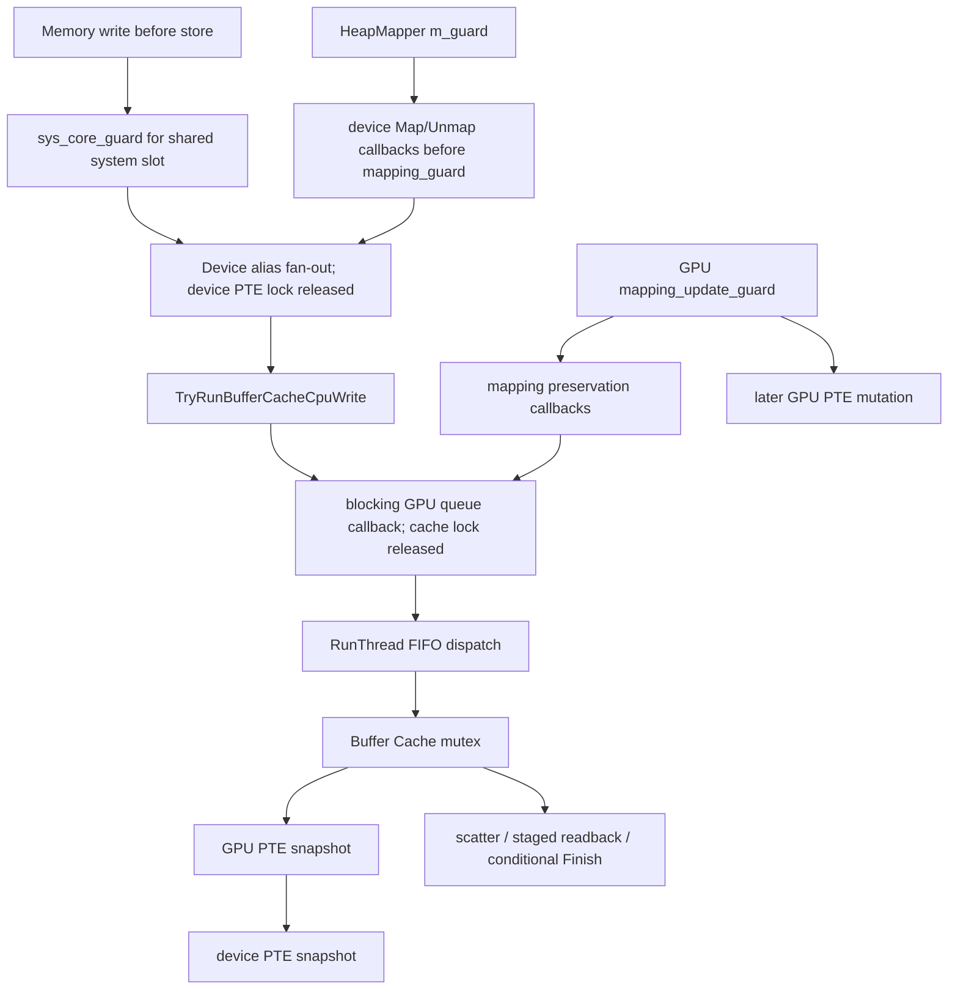
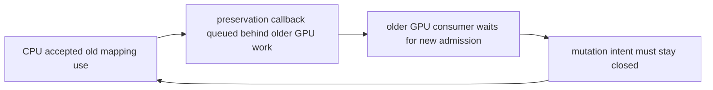

# M3B-F2 implementation assessment

Follow-up: the subsequent **candidate-only** protocol in
[`m3b_candidate/README.md`](m3b_candidate/README.md) closes the known admission
counterexamples under explicit immutable-plan/continuation contracts, with
production ThreadManager and extracted Memory tests. Production remains
unchanged; the blocked insertion designs below are retained as negative controls.

Date: 2026-10-14. Starting HEAD: `bc3d0d1984` on
`codex/fix-cpu-gpu-write-coherency`, with a clean worktree. Baseline merged
production revision: `3de1870c78`. All existing local commits are retained.

**Status: integration blocked at the admission insertion review. F2 is not
fixed. No production transaction, admission gate or eligibility fast path was
enabled.** The original F2 `--require-fixed` check still fails. The new tests
below reject specific unsafe insertion designs; they are not a repaired-code
result and do not prove that every possible implementation is impossible.

The task now explicitly authorizes scoped M3B production work. This assessment
does not use the earlier prohibition on M3B as its reason to stop. It applies
the present task's lock-cycle/unsafe-integration stop condition: a cache-local
admission adapter cannot safely block the GPU worker while a CPU reservation
depends on a later callback on that worker. The minimal outstanding dependency
is a queue-aware old-use/admission boundary, composed with a stable CPU
lookup/registration handshake. Neither is supplied by callback acknowledgement.

## 1. Prerequisite review

### `518c99aaac`: CPU CopyBlock

Reviewed the current `Memory::Impl::CopyBlock`, `WalkBlock`,
`ReadBlockImpl<false>`, `WriteBlockImpl<false>` and both IO callers.

- The source address is used for a complete owned snapshot before destination
  copy stores. This fixes the old destination-as-source traversal.
- Physical overlap in both directions and repeated destination aliases are
  handled by that snapshot and logical destination write order, not by virtual
  disjointness or per-chunk memmove.
- Source read preservation precedes destination copy stores. Bounds and known
  destination holes are rejected; incomplete source reads return false before
  copying the snapshot into the destination.
- Snapshot bad_alloc/length_error return false. Later preservation exceptions
  propagate and can leave a completed prefix. A concurrent mapping hole can
  leave noncontiguous completed chunks; there is no rollback or exact-extent
  result. The header states this limitation.
- `ReadIoMemoryImpl` now propagates false as ResultInvalidPointer; the write IO
  caller already checked it. Source-sized allocation/copy and preflight remain
  confined to this CPU copy path.
- Preflight is not a mapping pin or a concurrent producer exclusion mechanism.
  **CopyBlock remains excluded from the proposed F2 transaction.**

The old revision `52ae351066` fails `run_copy_block_tests.py --revision` as
expected. Current production-function copy tests pass, including physical
overlap, unaligned/split ranges, aliases, holes, allocation failure and partial
preservation failure. No blocking defect was found in its stated bounded
contract; it must not be promoted into an atomic transaction by wrapping it.

### `80eb1e8f40`: host callback acknowledgement

Reviewed `RunAcknowledgedCallback`, both rasterizer helper methods, their callers
and the actual ThreadManager queue/wait/failure/Stop implementation.

- Pending -> Running and Pending -> Cancelled arbitrate by one atomic CAS.
  Cancellation prevents even a retained late closure from invoking its action.
- Running retains the shared request and captured result. An early queue/stop
  wake waits for the promise's actual completion; it cannot free the active
  action's payload. No queue/cache/PTE lock is held by that future wait.
- The action reports exceptions through the promise and rethrows on the
  executing thread, retaining existing GPU worker failure handling. GPU-thread
  inline execution finishes synchronously; inline exceptions still propagate.
- The legacy adapter excludes NCE mode, including alignment emulation that
  calls WriteBlock from signal context. Default invalidation also retains the
  old body. No new signal-context promise/future/wait is introduced.
- nullopt is distinct from completed false and true. The legacy `.value_or(false)`
  is explicitly **not** a new transaction preservation result. There is no new
  F2 caller consuming that adapter as success in this assessment.
- Callback completion is host execution evidence. Existing staged readback
  uses runtime.Finish before WriteBlockUnsafe copy-back; that concrete action,
  not the promise alone, establishes its device readback ordering.

Actual ThreadManager and standalone acknowledgement tests pass. No blocking
defect was found in this callback contract. It supplies neither mapping pins nor
permission for an older GPU command to cross a new mutation/admission boundary.

## 2. F2 before/after status

Before any new changes, the requested command was run:

```powershell
python tools/physical_coherency_tests/run_write_coherency_witnesses.py --cxx g++ --case f2 --repeat 1 --require-fixed
```

It failed with exit 1: `F2 expected=77 observed=10 backing=77`. The same fixed-code
assertion against the generated executable was recorded in
`.diagnostics/m3b-f2-insertion-audit/f2-baseline.log`. The original witness and
assertions are unchanged. Since no production transaction was safely enabled,
there is **no passing after result**. All five existing defect witnesses still
reproduce; a successful witness-runner exit means defect reproduction only.

There is an additional test-harness constraint for eventual integration: the
existing fixture pauses CPU store until a synchronous GPU read returns. An
implementation that correctly blocks that read can deadlock that rendezvous.
The eventual protected-path regression needs a separate GPU-attempt thread,
evidence that it reached admission, and a CPU-store release independent of the
read's completion. Keep its stale-byte assertion and old-code control; do not
make the expected byte pass by bypassing the actual transaction. The original
witness was not rewritten to conceal this distinction here.

## 3. Actual production wait graph and intended insertion points



The graph names existing edges, not new locks. GPU-thread RunOnGpuThread is
inline; CPU callers wait on the FIFO queue. SubmitList only carries channel and
command entries; it has no F2 physical-use or mapping-reservation payload.
Scheduler::Push interprets work on the worker, before Buffer Cache knows the
draw/dispatch's complete bound ranges. Map/MapSparse/Unmap currently serialize
mutation with mapping_update_guard, callbacks and then PTE changes. Device
Map/Unmap callbacks similarly precede PTE mutation. They do not acquire a
production old-use obligation for already queued work.

| Required insertion | Verified production site | What a safe adapter must cover |
| --- | --- | --- |
| CPU access entry and exit | memory.cpp Write<T>, WriteExclusive/128, WriteBlockImpl, ZeroBlock | Before pointer acquisition through successful exact post-store publication; no retained unpinned pointer |
| CPU mapping mutation | MapMemoryRegion, UnmapRegion, MapPages; SetCurrentPageTable/Reset lifetime | Intent before mapping/host changes; accepted old access drains before physical destination changes |
| First GPU tracking | BufferCache Register/ChangeRegister, MemoryTracker/WordManager cached protection, Memory::RasterizerMarkRegionCached | Registration must drain/handshake with a CPU write that read an earlier untracked entry |
| GPU queue admission | ThreadManager::SubmitList/PushCommand, RunThread -> Scheduler::Push | Older accepted GPU work must not become a new blocking reader behind a later mutation intent |
| GPU upload | SynchronizeBuffer -> ForEachUploadRange -> UploadMemory -> immediate/mapped reads | Admission before cache/PTE locks, retained through actual backing read and transfer staging, not just enumeration |
| GPU producers | MarkWrittenBuffer, draw/dispatch binding paths, FlushGatherWrites/ResolveScatter | Overlapping staged/scratch writes and pending scatter use the same conflict boundary |
| Preservation | TryRunBufferCacheCpuWrite, OnCPUWrite, DownloadBufferMemory | Explicit result plus old-use context; do not recursively acquire admission from the waiting CPU's callback |
| Device mapping | DeviceMemoryManager::Map/Unmap | Intent before callbacks, not only inside mapping_guard; stable reverse alias enumeration |
| GPU mapping | MemoryManager::Map/MapSparse/Unmap | Intent before mapping_update_guard/callbacks and no reverse device/GPU owner order |
| Retirement | System shutdown, GPU/renderer teardown, manager destruction/backing epoch changes | Seal new operations, cancel pending, drain running and retain Unknown owners before resource destruction |

Kernel/HLE call-site locks also matter: HeapMapper Map/Unmap retain m_guard;
IO copy methods require their kernel page table lock. An added wait cannot be
assumed safe simply because the page-table mutex itself has been released.
This assessment introduces no new wait under these locks.

## 4. Rejected admission design: FIFO/mutation cycle

The first candidate separated a CPU's stable mapping reservation from later
exclusive data access. The CPU accepted an old mapping use before preservation.
A mutator closed new admission before draining that old use, as required. A GPU
consumer attempted its new admission at the Buffer Cache preparation boundary.

The following interleaving invalidates that placement:

1. CPU write retains an accepted old mapping use.
2. An older GPU command is already running, paused before cache admission.
3. A mapping mutator publishes intent, closes new admission and waits for the
   accepted CPU old use to retire.
4. CPU queues its preservation callback behind the older GPU command and waits.
5. The older GPU command now tries to acquire a *new* use. Admission is closed.



Passing the CPU old-use token only to its preservation callback does not let
the **older** GPU command reach completion. Acquiring exclusive CPU data access
even earlier has the simpler variant: older GPU consumer waits on CPU writer,
CPU writer waits on its callback behind that consumer. These must be avoided
before adding a blocking guard to SynchronizeBuffer.

`run_m3b_insertion_audit.py` demonstrates the first cycle with the complete
production ThreadManager/RunThread/bounded queues. The admission gate and older
consumer/cache boundary are **candidate fixtures**, not an existing production
coordinator. An actual ExecuteCallback command represents the older worker
operation; actual queue acceptance and blocking waits establish FIFO ordering.
Each edge reaches an explicit event before assertions. Ten repetitions observe
the queued preservation has not executed and both CPU/mutator remain waiting.
The fixture old use is then deliberately abandoned, before any store, to unwind
the test. Cleanup is not a proposed transaction rollback or cancellation API.

This is evidence that this insertion design would introduce a production queue
cycle, not a claim that unmodified Citron has an admission gate deadlock.

### Whole-owner queued-use fallback also requires a progress boundary

Merely moving a broad old-use lease to queue acceptance is not a complete
solution. RunThread deliberately polls suspended channels because a channel's
semaphore acquire can require a CPU write or another channel to proceed. If a
whole-manager queued GPU use is retained while that channel is suspended, a
mutator may wait for it while its intent blocks the required new CPU write:

```text
mutator drains old GPU use
  -> suspended GPU channel needs guest CPU store
  -> guest store needs admission closed by mutator
  -> mutator drains old GPU use
```

The insertion audit also reproduces this relation through production RunThread.
The scheduler fixture retains a suspended dependency until an atomic guest-store
spy changes; the admission/lease adapters remain fixtures. All three waits are
reached with events. Cancelling the unexecuted fixture mutation reopens admission
only for cleanup, allowing the guest-store spy and suspended use to retire.
That cleanup is not implemented as a production mutator retry contract.

Thus the coarse queue-lease alternative must also define bounded physical/range
scope or a safe mutation defer/cancel policy before PTE side effects, while
preserving guest/other-channel progress. An unrelated mapping change must not
close every CPU producer needed by a suspended channel. Reopening intent
unconditionally violates admission ordering; retaining the lease indefinitely
can strand mutation/shutdown. Existing void Map/Unmap interfaces do not provide
that scheduler continuation, ordered retry, or caller-lock release contract.
This second candidate is also rejected, rather than claimed production-ready.

## 5. Rejected fast path: cached flag alone

The second case extracts current `Write<u8>`, `GetPointerImpl` and
`RasterizerMarkRegionCached`. A fixture PTE Raw load pauses after taking its
snapshot. The CPU has obtained the uncached/raw-pointer route; the other thread
then executes production cached marking, simulates uploading old backing, and
allows the CPU instruction to finish.

Result in all ten repetitions: backing becomes 77, notification count remains
zero, and the fixture upload remains 10 even though the PTE is now cached.
Changing the PTE or fastmem virtual permissions does not retroactively guard
the raw physical pointer used by this C++ store.

PTE encoding/storage, virtual Protect and the upload are fixtures; the test does
not execute mprotect, Vulkan or real Buffer Cache upload. It proves the actual
Memory branch/store can miss a later registration under that explicit adapter.
The original F2 witness separately proves real extracted cache synchronization
can consume pre-store dirty state. No native signal claim is made.

Consequently, a guard only inside HandleRasterizerWrite misses an initially
untracked write. A selective fast path needs a proven per-range/epoch handshake
joined by initially untracked controlled writers **and** first registration, plus
stable process mapping use. A second unprotected flag check or mapping stamp
does not close the check-to-store interval. A global mutex on every scalar was
not substituted for this requirement.

## 6. Minimal unresolved dependency and next design boundary

The missing dependency is **queue-aware access admission**, composed with the
first-registration handshake; it is not a full Vulkan completion registry.
A viable continuation must supply one of:

- Old-use ownership accepted before a GPU command can be trapped by a new
  mutation intent, retained through its actual cache access and queued-work
  cancellation. Its mapping/resource scope must be real, not a token without
  ownership. A whole-owner GPU command lease needs its contention measured and
  does not justify a whole-manager lease on every scalar CPU access.
- Nonblocking parking/retry of a conflicting GPU operation before irreversible
  draw/dispatch/cache side effects, allowing the required preservation work to
  progress. This needs an actual scheduler continuation/cancellation boundary;
  waiting in the single worker or repeatedly running its FIFO loop recursively
  is not such a boundary.

Both alternatives must let existing admitted work preserve old mappings after
mutation intent closes new admission, without allowing genuinely new work to
bypass that intent. Their interaction with suspended channels, SubmitList
failure/cancellation, CPU/kernel locks and callback reentrancy remains to be
proved, including the whole-owner suspended dependency demonstrated above.
Neither alternative is implemented in this change. The tests
reject the simple adapters; they do not prove these alternatives infeasible.

Only after this dependency is resolved should stable process/device/GPU mapping
uses be composed with an exclusive physical store obligation, in a consistent
owner order and outside cache/PTE locks. Initially untracked controlled writers
must participate in a selective registration epoch without a global scalar
mutex. No candidate positive eligibility predicate is activated here.

## 7. Preservation, publication and failure requirements retained

TryRunBufferCacheCpuWrite's optional result is necessary but insufficient.
Its completed action can still call OnCPUWrite -> WriteMemory, which publishes
CPU dirty state **before** a store and can widen a hot write's extent. A future
transaction must separate preservation from exact post-store CPU publication;
it cannot use the existing deferred bit as a completed-write record. The
failed-CAS witness still demonstrates premature dirtying. CAS itself is not
moved to another thread in this assessment.

Normal staged DownloadBufferMemory waits/copies back before its callback returns,
but its ordinary download path clears some dirty bookkeeping before transfer.
A failure therefore needs fail-stop/Unknown handling with authority/resource
retention, not merely rejecting the CPU store and reopening the range as clean.
Mapped upload similarly consumes dirty ranges before its data read/copy; its
early error returns must not be treated as successful visibility by an adapter.

The required future states remain:

| State | Required handling; not implemented here |
| --- | --- |
| Accepted / preservation pending | Retain mapping/backing ownership; do not expose new CPU data |
| Preservation complete | Confirm optional result and concrete readback visibility before storing |
| Writing | Conflict exclusion continues; metadata/extents allocated beforehand |
| Completed and published | Exact successful extents published after store, then release |
| Cancelled before modification / shutdown rejected | Prevent future store execution; no completed CPU publication |
| Partial/Unknown | Never call it unexecuted; retain obligations and stop affected execution until safe release is proven |

CopyBlock remains excluded. WriteBlock's boolean and continuing-after-hole
behavior cannot be assumed to carry exact completed extents. Successful CAS
must publish exact bytes; failed CAS must publish none. These are requirements,
not newly passing cases.

## 8. Test coverage and validation

`run_m3b_insertion_audit.py --cxx g++ --repeat 10` reproduces both queue/admission
cycles and the registration gap. Generated sources, SHA-256 method hashes and per-run logs are in
`.diagnostics/m3b-f2-insertion-audit`. Its candidate admission, PTE storage and
protection/upload spies are identified in `extraction.json`. It does not import
M3A's gate and call that a production integration.

Windows GCC 13.2.0 checks for this assessment:

| Check | Result |
| --- | --- |
| Original F2 fixed-code assertion | FAIL as expected, exit 1, 77 backing / 10 cache |
| CopyBlock old-code control | FAIL as expected, exit 1 |
| Current CopyBlock regressions | PASS |
| Callback acknowledgement regressions | PASS, 10 repetitions with 200 start/cancel races each |
| Four GPU lifecycle runners | PASS, including actual queue/Stop/failure tests |
| M3A protocol / M2 deterministic and random model | PASS; not evidence of F2 production integration |
| Physical resolver / M0 DMA / M1-M1.1 shadow | PASS; shadow uses already fetched real pinned fmt headers |
| Nine gather-buffer runners | PASS |
| Existing five F1/F2 witnesses | Defects still reproduce; not fixed-code passes |
| Linux / ASan-UBSan / TSan | Unavailable in this Windows environment; not passing results |
| Full emulator link / Android build / actual GPU or NCE execution | Not performed |

Suite logs/results are under `.diagnostics/m3b-f2-validation`. Existing Vulkan
headers are supplied by a process-local include path; no dependency settings or
submodules changed. No Linux environment or sanitizer runtime was installed.

The requested 18 transaction cases are not falsely recorded as implemented:

| Requested cases | Current status |
| --- | --- |
| 1-3,17 delayed store, upload conflict, later read, dirty consumption | Original stale-cache witness remains failing; no protected-path after result |
| 4 dirty complement | Existing ordered preservation regression passes; concurrent transaction remains unsupported |
| 5-8 failed/successful CAS, split scalar, block hole | Failed CAS defect reproduced; no new commit/extent semantics for the other cases |
| 9-10 conflicting/disjoint writers | No production admission or independent-progress claim |
| 11-12 device/GPU remap | Mapping insertion reviewed; candidate old-use/mutation queue cycle reproduced; no admitted store/remap proof |
| 13-14 callback rejection/shutdown | Prerequisite host callback/lifecycle tests pass; no transaction state machine |
| 15 reentrancy/lock inversion | Candidate queue cycle rejected; existing inline callback tests pass; no new lock order enabled |
| 16 backing replacement | No production resource pin/drain integration |
| 18 unsupported alias rejected before effects | No positive eligibility/new admitted path; no fabricated alias-admission success |

## 9. Scope, performance and commits

No transaction paths are enabled, so no new production fast/protected admissions,
upload waits, mutation drains, Finish calls, preserved bytes or Unknown counters
exist to benchmark. Production overhead from this assessment is zero because
production files are unchanged. Fixture timings are not FPS/throughput evidence.

F1 native access/alignment, raw/kernel pointer writes, cross-DAddr F3 replicas,
image/buffer authority overlap, unsupported DMA and unknown layouts remain
unresolved. No DirectGuestView, dma-buf ownership or general UMA path changes.
An old staged fallback is not presented as a safe eligibility decision.

All prerequisite commits remain intact. This assessment commits only the
insertion-audit runner and this report. The runner commit is
`56b689dfaf6c73d41803aec914e7ae5bcd015f43`. Resolve the report's own commit with:

```sh
git log -1 -- tools/physical_coherency_tests/M3B_F2_IMPLEMENTATION_REPORT.md
```

No push or merge. **F2 completion criteria remain unmet.** This is the scoped
unsafe-design stop/report outcome authorized by sections 8 and 14 of the task,
not a production fix or a claim that scoped M3B work was unauthorized.
