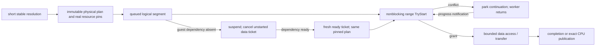

# M3B controlled-access admission candidate

Standalone candidate, 2026-10-14, based on branch
`codex/fix-cpu-gpu-write-coherency` at `8f8f4804e3`. **No production source,
queue policy, renderer behavior or build target is changed.** This implements
and tests an admission protocol, not a completed production F2 repair.

## Decision

The chosen candidate needs all three mechanisms:

| Mechanism | Decision and purpose |
| --- | --- |
| Scheduler continuation | Required. A GPU worker must park a conflicting logical segment and return, allowing preservation/release work to run. A per-lane head retains channel order; another lane can progress. This is not a recursive queue pump or command-list replay. |
| Immutable transfer/access plan | Required by this design. Queue/suspend retains actual allocation and representation pins, immutable physical footprints and an immutable access view. It retains no mapping-use lease. Existing plans never retranslate a changed VA. |
| Range admission | Required for actual data access. Shared reads and exclusive writes conflict by allocation identity and byte interval. Intent order is per conflicting ready request; disjoint scopes proceed independently. The prototype's bounded metadata mutex/list is not a measured production data structure. |

A whole-manager lease across a suspended channel is rejected. A cache mutex held
while waiting for preservation is rejected. A cached-bit check followed by an
unguarded pointer store is rejected. None is reintroduced as a fallback.

## Ownership and execution are separate



The rules are:

1. Resolution is short and RAII-owned. Mapping intent closes new resolution and
   drains only active resolution, before old-map preservation and PTE apply.
   The last resolver emits a progress notification, including on exceptions.
2. A plan owns the **actual fixture allocation** and representation, not merely
   an epoch or weak lifetime stamp. Captured physical offsets never change.
   Old work and mutation preservation can execute from these pins while new
   resolution is closed. Mapping replacement does not free the old resources.
   The pin must also prevent allocator reuse of those physical bytes; keeping
   the surrounding HostMemory arena alive alone is not sufficient. Real device
   resources must retain their device/dispatch lifetime as well as their buffer.
3. Only a ready lane head obtains a data ticket. A lane tail retains its plan
   but must not reserve priority ahead of an independent CPU dependency writer.
4. TryStart never waits. A parked operation has made no irreversible effects.
   Its logical job remains unfinished even though its queue callback returned.
5. A suspended segment has no data lease and cancels its unstarted ticket. Its
   plan pins survive. Resume creates a fresh data ticket; the next operation in
   that lane remains behind it. A different mapping range's mutation does not
   close semaphore-producer resolution on an unaffected range.
6. A running transfer retains its data ticket until its actual completion and
   visibility evidence. Host callback completion alone does not release it.
   A CPU-preservation action can keep the lease, hand control to the CPU store,
   and release only after exact post-store publication.
7. Nested inline callbacks inherit the current execution context. Conflicting
   reacquisition returns Reentrant instead of waiting on the parent's lease.
   A preservation action uses its granted ticket; it must not acquire it again.

`driver.h` is an independent **test-only continuation dispatcher** which posts
callbacks through the actual ThreadManager. It does not replace RunThread or
modify the real scheduler. Logical completion, parking, suspension, cancellation
and a callback's host acknowledgement are distinct states. Actions and dependency
queries must be bounded and nonblocking; they run outside protocol metadata.
There is no supported API for awaiting a child operation from a GPU action.

The dispatcher has 64 job slots, fixed head snapshots and out-of-lock retirement
of completed/cancelled payloads. Capacity/allocation rejection occurs before a
new action runs. If registration intent was already accepted but submission
fails, its owner must seal the affected domain; it cannot silently reopen fast
entry after uncertain preservation. No fake rollback is provided.

## CPU uncached store versus first registration

PhysicalDomain canonicalizes a gate by `(actual allocation identity, page offset)`.
Different virtual views of one physical page obtain the same gate. Its node
pins the actual allocation, and a fast accessor owns the node through exit.
Every eligible first registration must participate, including every page in a
coarse cached/protection region. A freshly created gate is not evidence that an
already-running cache is untracked: production bootstrap must quiesce/register
existing coverage or reject it. Tracked is monotonic for this incarnation.

Fast entry is restricted to a complete validated uncached Memory view whose
actual store cannot call GPU preservation or wait on another executor. A
cached/debug/hole/unknown view cannot enter this route. Otherwise registration
could wait for a fast accessor that itself waits for GPU work. A tracked gate
always uses protected admission even if a private PTE view still has a raw
pointer. The candidate's resident fixture storage avoids lazy backing creation;
real snapshot adapters must not materialize backing through a GPU wait under
PTE locks. All transfer plans must include the actual coarse read/write footprint,
while CPU publication still records only the bytes changed.

Each page has one atomic word: Tracked, Closing, Closed, and a writer count.
CPU entry occurs **before production GetPointerImpl or any real store**:

```text
already-resolved immutable view and page pins
  -> reject closed backing epoch
  -> CAS increment page fast-writer count while Untracked and not Closing
  -> recheck backing epoch (otherwise release provisional count and reject)
  -> actual GetPointerImpl + store
  -> release decrement count
```

Registration ordering is:

```text
allocate/enqueue exclusive range ticket first
  -> CAS Closing on canonical page (close new untracked entry)
  -> park until old fast-writer count is zero
  -> obtain the already-prioritized range ticket
  -> actual cached marking + initial backing upload
  -> publish Tracked
  -> release registration's range ticket
```

The preaccepted ticket matters: a CPU which sees Closing cannot overtake a
registration callback that has not reached the real GPU queue yet. If the close
CAS loses to another registrar, cancel only the unstarted ticket. If the backing
is sealed, no new data action or fast store can begin. Already running stores
finish or become Unknown; they are not retrospectively called unexecuted.

### Linearization and visibility argument

- **Fast writer first:** its successful count CAS precedes the registrar's
  Closing CAS in the atomic modification order. Registration cannot upload until
  that count is released. Store bytes happen-before the release decrement; the
  registrar's acquire observation of the drained word observes them.
- **Registrar first:** Closing prevents a subsequent fast count CAS. The writer
  takes the protected path behind the preaccepted registration ticket. It cannot
  use a cached-bit snapshot to bypass admission.
- **Multiple writers:** the last release RMW and acquire drain observation cover
  preceding release RMWs in the release sequence. Registration waits for all
  writers, including physical aliases using the same canonical node.
- **Split scalar:** FastSet uses two fixed slots, enters every required page
  before GetPointerImpl/store, and releases all provisional counters on admission
  failure. It allocates nothing and performs no partial store on that rejection.
  General large blocks do not use this bounded fast path.
- **Backing seal race:** a provisional count remains visible while the writer
  rechecks the shared epoch word. If sealing wins, it releases the count without
  storing. PhysicalDomain closes the epoch, closes node creation and all page
  gates, and seals pending range tickets. Drained requires both data obligations
  and fast accessors to retire. New epoch ownership is a separate domain.

There is no global metadata mutex or manager-use RMW in the untracked byte-store
entry/exit. The fast path uses page-local atomics, shared node ownership, and
backing-epoch loads. This is not a claim that shared_ptr/atomics are free, nor
that the complete production resolution path is cheap. No FPS claim is made.

## Exact writes, failure and resources

The request states are Pending, Running, Writing, Published, Done, Cancelled and
Unknown. Publication capacity is prepared before Running/Writing. The executor
must supply exact extents from a bounded plan; post-store publication uses no
new vector allocation. Failed CAS is a terminal **completed no-store compare**,
not cancellation: the real atomic result permits Writing -> Done without CPU
publication. Successful CAS publishes its actual modified bytes.

The extracted block walker can complete a prefix and return false at a hole.
The test-only observer records extents after the actual production memcpy.
Those known completed bytes can be published as Partial; no whole-operation
success or rollback is inferred. Invalid/uncertain publication becomes Unknown
and conservatively quarantines the allocation.

Running, Writing and Unknown obligations self-retain protocol state and actual
pins. Recovery ownership is prepared before the write. Pending cancellation
prevents future action; it cannot cancel Running/Writing as unexecuted.
Unknown is released only after sealing and a trusted quiescence assertion, with
no other executor still Running/Writing. That releases lifetime, not data
recovery or successful publication. Payload/pin destruction occurs outside
metadata locks; a destructor reentry test checks this property.

The candidate uses a mandatory `ControlledSingleReplica` scope certificate.
**That certificate is supplied by the fixture, not discovered by this code.**
Bounds and repeated overlapping physical spans are validated, and Unsupported
is rejected before an action. A production eligibility adapter must establish
that certificate: no second DAddr replica, image authority, unknown layout or
unobserved native/raw producer may overlap. This is not an F3 coordinator.

## Actual code executed and fixture boundaries

`run_m3b_candidate_tests.py` builds one TU containing:

- The complete production ThreadManager class and RunThread definitions, actual
  bounded MPSC/SPSC queues and stop-token waits, using the existing lifecycle
  runner's platform/Core/renderer/engine shims.
- Extracted production `Memory::Impl::GetPointerImpl`, scalar Write,
  WriteExclusive, WalkBlock, WriteBlockImpl and RasterizerMarkRegionCached.
- The actual `Common::AtomicCompareAndSwap` implementation (byte CAS in these
  tests), not a compare-and-store shim.
- This candidate's protocol and continuation adapter.

The Memory fixture is an **immutable pinned access view**, not the live process
page table. A remapped logical VA does not retarget that view's physical bytes.
Production currently has no such access-view adapter; it remains an integration
requirement. The notification stub records pre-notification only. It does not
execute legacy OnCPUWrite's premature dirty publication. A production adapter
must split preservation from exact post-store commit instead of using
`.value_or(false)` or marking a failed compare as completed CPU data.

Replica bytes, GPU dirty preservation, upload, device-completion/visibility,
mapping ownership and semaphore dependencies are explicit fixtures. No Vulkan
device or native signal runs. The device-pending test retains its range lease
after the actual GPU-thread callback returns until a separate fixture completion
event establishes visibility. It does not invent Vulkan completion evidence.

Instrumentation is limited to existing lifecycle rendezvous, a PTE raw-load
rendezvous, an observation after actual block memcpy, and a pause between fast
count acquisition and epoch recheck. Generated sources and SHA-256 extraction
records are saved under `.diagnostics/m3b-candidate/normal`.

## Counterexample matrix

| Cases | Positive candidate evidence |
| --- | --- |
| old_mutation | Older actual GPU-thread work, closed mapping intent, CPU preservation, conflicting mutation preservation all complete; mixed bytes remain 99/77/99 |
| suspended, new_cpu_suspended | Suspension releases data admission; lane tail cannot pass; fresh CPU producer progresses while an unrelated mapping intent stays closed, then resumes the old channel |
| upload | GPU attempt parks during CPU store; another lane runs; later upload sees 77 after exact publication |
| cas | Real failed compare publishes nothing; real successful compare publishes one byte and preserves GPU complement |
| split_partial | Real split-page scalar bytes; real block copy prefix plus hole, false result and exact completed extent |
| writers | One real CPU store pauses inside pointer lookup; disjoint writer completes while overlapping writer stays parked |
| cpu_first, gpu_first | Real uncached lookup/store precedes registration or follows it; registrar-before-enqueue gap cannot be overtaken |
| two_fast, multi_fast | Physical aliases share one node; all writers/pages drain before upload; failed multi-page entry stores nothing |
| remap, resolver | Pinned old physical destination survives remap; closed resolution does not strand old plans; last resolver/exception wakes mutation continuation |
| shutdown, registration_seal, fast_seal_race | Pending rejection, running store completion, page creation/fast entry sealing and provisional-count seal race |
| reentry, inline_reentry | Explicit and actual ThreadManager inline callback reentry reject own conflicting admission without self-wait |
| unknown, unsupported, callback_failure | Quarantine/pin retention, malformed extents/unknown scope, actual worker failure and skipped callback acknowledgement |
| device_completion | Callback return does not retire a device-pending data lease or permit premature readback |
| cleanup, bounded | Resource destructor reentry outside metadata, accessor-node lifetime, bounded/reaped completed continuation metadata |

## Reproduction and promotion gate

```powershell
python tools/physical_coherency_tests/run_m3b_candidate_tests.py --cxx g++ --repeat 20
python tools/physical_coherency_tests/run_m3b_insertion_audit.py --cxx g++ --repeat 10
```

Windows x64 GCC 13.2.0: **24 candidate cases, 20 repetitions each**, pass. The old
insertion audit remains a negative control: its unsafe adapters still reproduce
the two cycles and the registration gap. Existing production F1/F2 witnesses
remain known failures; their unchanged production path was not silently fixed.
The baseline lifecycle, M3A/M2, resolver, DMA, shadow, nine gather suites, CPU
CopyBlock and preservation-ack regressions also pass. Sanitizer/Linux/device
limits and exact run records accompany the local validation logs. GCC's minimal
ASan/UBSan and TSan link probes fail because libasan/libubsan/libtsan are absent;
no sanitizer execution is counted as passing. Linux and real device/NCE
execution were not performed. Full regression logs are in
`.diagnostics/m3b-candidate-validation`; candidate logs and extraction provenance
are in `.diagnostics/m3b-candidate/normal`.

The known admission counterexamples are closed **under the candidate's stated
contracts**. Before any production scheduling change, the remaining promotion
requirements are real immutable allocation/representation pins and access
views, actual pure resolution/eligibility adapters, a safe engine segment
continuation boundary before irreversible effects, and real transfer visibility
and teardown integration. Footprints discovered only after effectful decode,
uncontrolled stores (including direct JIT fastmem), NCE/native signals,
kernel/raw pointers, F3 and images remain ineligible.

The test dispatcher must not be transplanted as a second production GPU thread.
Actual integration should implement its logical park/resume semantics in the
existing scheduler. A suspended external dependency that is never satisfied is
not promised to complete; it must be cancellable as an unstarted segment at
shutdown. No whole-command rollback or replay is authorized by these tests.
